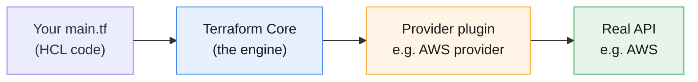
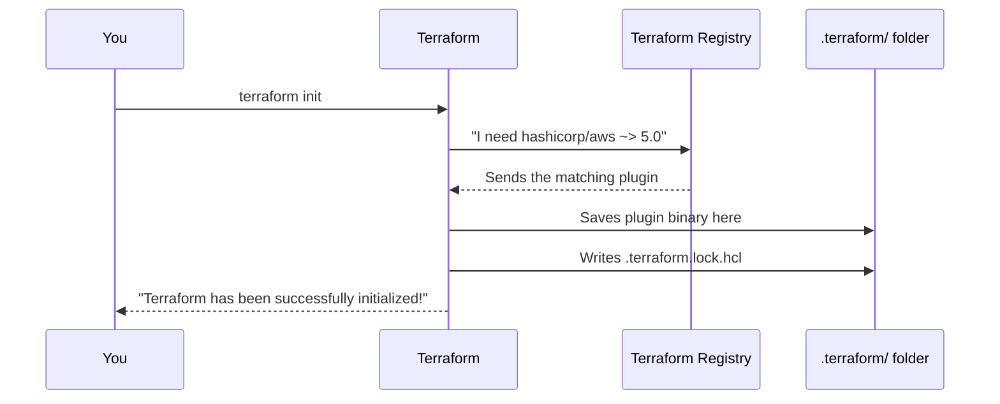
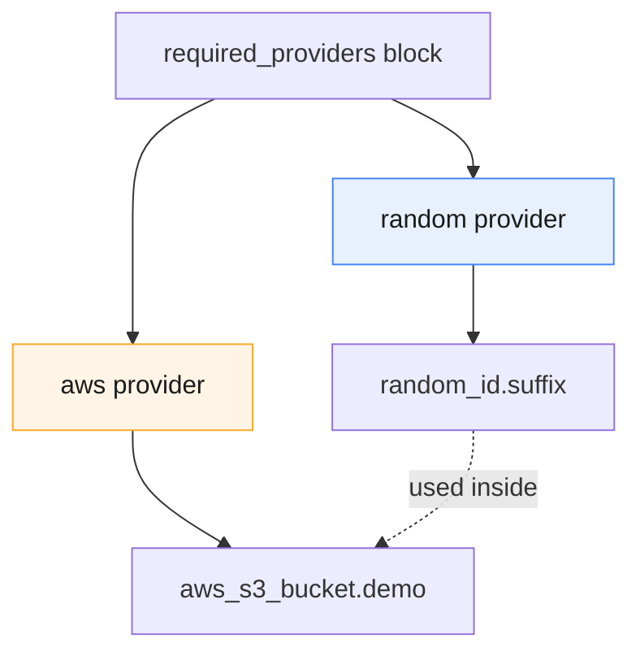
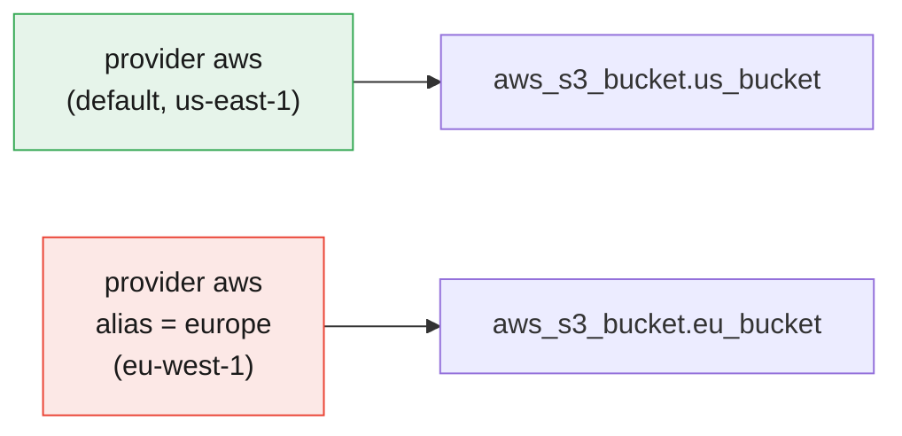

# Terraform Providers Explained

:::info[Continuing from the last guides]
This page continues from **[Terraform Core Commands](./terraform-core-commands)** and **[Terraform Safety Nets](./terraform-tags-safteynets)**. Same sandbox, same `main.tf` habits — now we go one level deeper into what actually makes `terraform init` work: **providers**.
:::

:::tip[Start your sandbox here]
👉 **[Launch the official Terraform Sandbox](https://developer.hashicorp.com/terraform/sandbox)** — it comes with Terraform, Docker, LocalStack, and the AWS CLI already installed. No signup, no local setup. Every example below can be typed directly into it.
:::

---

## What Is a Provider, Really?

Terraform itself doesn't know anything about AWS, Azure, GitHub, or any other service. It only knows the general language (`resource`, `variable`, `plan`, `apply`...). A **provider** is a plugin that teaches Terraform how to talk to one specific service's API.

:::tip[Think of it like a translator]
Terraform speaks one language. AWS, Azure, and GitHub each speak their own language. A provider is the translator standing between them — it takes your `resource "aws_s3_bucket" ...` and translates it into real AWS API calls.
:::

Without a provider, `resource "aws_s3_bucket" "demo" { ... }` is just text. The **AWS provider** is what actually knows how to create, read, update, and delete an S3 bucket.



---

## 1. Declaring a Provider

There are two parts to setting up a provider. Beginners often only see the second part, so let's look at both.

### Part A — `required_providers`: which provider, and which version

```hcl
terraform {
  required_providers {
    aws = {
      source  = "hashicorp/aws"
      version = "~> 5.0"
    }
  }
}
```

| Line | Meaning |
|---|---|
| `aws =` | A local nickname you'll use elsewhere in your code |
| `source = "hashicorp/aws"` | Where to download it from — the Terraform Registry, under `hashicorp`'s namespace |
| `version = "~> 5.0"` | Only use version 5.x — never jump to 6.0 automatically |

:::info[Why pin a version?]
Providers get updated often. If you don't pin a version, a future `terraform init` on a new machine could download a newer provider that behaves differently — and your "same" code could suddenly plan different changes.
:::

### Part B — `provider`: how to connect (region, credentials, etc.)

```hcl
provider "aws" {
  region = "us-east-1"
}
```

This is where you configure the provider itself — which region, which account, which credentials.

:::note
`required_providers` says **which plugin to download**. `provider "aws" { ... }` says **how to use it**. You almost always need both.
:::
:::warning[Sandbox gotcha: "Duplicate required providers configuration"]
The HashiCorp Sandbox already comes with a `terraform.tf` file that has its own `required_providers` block. Terraform allows **only one** `required_providers` block per project — if you add a second one in `main.tf`, `init` fails with a duplicate error.
 
**Fix:** don't write a new `required_providers` block. Either edit the one already in `terraform.tf`, or delete `terraform.tf` if you want your own in `main.tf`. Never have two at once.
:::
### Try it yourself

```hcl
terraform {
  required_providers {
    aws = {
      source  = "hashicorp/aws"
      version = "~> 5.0"
    }
  }
}

provider "aws" {
  region = "us-east-1"
}

resource "aws_s3_bucket" "demo" {
  bucket = "my-provider-practice-bucket"
}
```

```bash
terraform init
```

```
Initializing the backend...
Initializing provider plugins...
- Finding hashicorp/aws versions matching "~> 5.0"...
- Installing hashicorp/aws v5.XX.0...
- Installed hashicorp/aws v5.XX.0 (signed by HashiCorp)

Terraform has been successfully initialized!
```

---

## 2. Where Does `init` Actually Download the Provider?



Two things get created:

| What | Where | Purpose |
|---|---|---|
| The actual plugin (a program) | `.terraform/providers/` | The real translator code Terraform runs |
| `.terraform.lock.hcl` | Your project's root folder | Records the **exact** version + checksum that was downloaded |

:::warning
Always commit `.terraform.lock.hcl` to version control (e.g., Git). It guarantees that you, your teammate, and your CI pipeline all download the exact same provider — not just "some 5.x version."
:::

:::tip
Never commit the `.terraform/` folder itself — it's just downloaded files, and it's usually already excluded via `.gitignore`.
:::

---

## 3. Version Constraints — What Do the Symbols Mean?

| Symbol | Example | Meaning |
|---|---|---|
| `=` | `= "5.31.0"` | Exactly this version, nothing else |
| `>=` | `>= 5.0` | This version or newer |
| `~>` | `~> 5.0` | Any 5.x version, but never 6.0 (the last number can grow) |
| `~>` (tighter) | `~> 5.31.0` | Any 5.31.x patch, but never 5.32 |

:::tip[Think of it like a leash]
`~>` is a leash: it lets the version wander within one "room" (like all of 5.x), but stops it from wandering into the next room (6.x) where things might work differently.
:::

### Try it yourself

Change `version = "~> 5.0"` to `version = "~> 5.31.0"`, then run:

```bash
terraform init -upgrade
```

```
- Finding hashicorp/aws versions matching "~> 5.31"...
- Installing hashicorp/aws v5.31.0...
```

`-upgrade` tells Terraform to re-check for the newest version that still fits your constraint, instead of reusing whatever the lock file already has.

---

## 4. Multiple Providers — Using More Than One Service

Most real projects use more than one provider at once — for example, AWS for infrastructure and GitHub for repository settings.

```hcl
terraform {
  required_providers {
    aws = {
      source  = "hashicorp/aws"
      version = "~> 5.0"
    }
    random = {
      source  = "hashicorp/random"
      version = "~> 3.0"
    }
  }
}

provider "aws" {
  region = "us-east-1"
}

provider "random" {}

resource "random_id" "suffix" {
  byte_length = 4
}

resource "aws_s3_bucket" "demo" {
  bucket = "my-bucket-${random_id.suffix.hex}"
}
```

:::note
This is a genuinely useful pattern: the **random** provider generates a unique suffix, so your S3 bucket name (which must be globally unique across all of AWS) doesn't clash with anyone else's.
:::



### Try it yourself

```bash
terraform init
terraform plan    # notice random_id generates a value, then aws_s3_bucket uses it
terraform apply   # type yes
terraform state list # See everything Terraform currently manages
terraform state show random_id.suffix #See the generated random ID The important value here is:hex
terraform state show aws_s3_bucket.demo # See the S3 bucket Terraform created you will see bucket = "my-bucket-xxxxxxxxxxx"
terraform destroy # type yes
```

---

## 5. Multiple Configurations of the *Same* Provider — `alias`

Sometimes you need the **same** provider twice — like AWS in two different regions. A single `provider "aws" { region = ... }` block can only hold one region. This is where `alias` comes in.

```hcl
provider "aws" {
  region = "us-east-1"
}

provider "aws" {
  alias  = "europe"
  region = "eu-west-1"
}

resource "aws_s3_bucket" "us_bucket" {
  bucket = "my-us-practice-bucket"
  # no "provider" line = uses the default (us-east-1) provider above
}

resource "aws_s3_bucket" "eu_bucket" {
  bucket   = "my-eu-practice-bucket"
  provider = aws.europe
}
```

:::tip[Think of it like two phone lines]
Both providers are "AWS," but each one dials a different region. The unlabeled provider is your default line. `aws.europe` is your second line — you explicitly pick it up with `provider = aws.europe` whenever you want to use it.
:::



:::info
Every resource that doesn't say `provider = ...` automatically uses the **default** (unaliased) provider block for its type. Only add `provider = aws.europe` where you specifically want the aliased one.
:::

### Try it yourself

```bash
terraform init
terraform plan
```

```
Plan: 2 to add, 0 to change, 0 to destroy.
```

```bash
terraform apply    # type yes — creates a bucket "in" each region
terraform destroy  # type yes
```

:::note[LocalStack note]
In the sandbox, LocalStack simulates regions too — both buckets will still show up locally, which is enough to see the `alias` mechanism working.
:::

---

## 6. Passing Providers Into Modules

If you organize your code into **modules** (reusable folders of `.tf` files), the module doesn't automatically know which provider configuration to use — you pass it in explicitly, just like a variable.

```hcl
module "eu_bucket" {
  source = "./modules/s3-bucket"

  providers = {
    aws = aws.europe
  }
}
```

:::tip
Think of `providers = { aws = aws.europe }` as saying: *"Inside this module, whenever you use the AWS provider, use my `europe` one — not the default."*
:::

:::note
This is intermediate territory — you don't need modules to use providers, but it's good to recognize this pattern when you see it in other people's code.
:::

---

## Quick Reference

```bash
# Download the providers listed in required_providers
terraform init

# Re-check the registry for a newer version within your constraint
terraform init -upgrade

# See exactly which provider versions are locked
cat .terraform.lock.hcl
```

```hcl
# Declare which provider + version
terraform {
  required_providers {
    aws = {
      source  = "hashicorp/aws"
      version = "~> 5.0"
    }
  }
}

# Configure the default provider
provider "aws" {
  region = "us-east-1"
}

# Configure a second, named configuration of the same provider
provider "aws" {
  alias  = "europe"
  region = "eu-west-1"
}

# Use the aliased provider on a specific resource
resource "aws_s3_bucket" "eu_bucket" {
  bucket   = "..."
  provider = aws.europe
}
```

## Cheat Sheet: Which One Do I Need?

| I want to... | Use this |
|---|---|
| Tell Terraform which provider and version to use | `required_providers` block |
| Configure region/credentials for a provider | `provider "name" { ... }` block |
| Lock everyone to the exact same provider version | Commit `.terraform.lock.hcl` |
| Use two regions (or two accounts) of the same provider | `alias` |
| Use AWS *and* GitHub *and* random in one project | Add each as its own entry in `required_providers` |
| Control which provider a module uses | `providers = { aws = aws.alias_name }` |

---

## Summary

- A **provider** is a plugin that translates your Terraform code into real API calls for a specific service (AWS, Azure, GitHub, etc.).
- `required_providers` says **which** provider and **what version**; `provider "name" { ... }` says **how to configure it** (region, credentials).
- `terraform init` downloads providers into `.terraform/` and locks the exact version in `.terraform.lock.hcl` — always commit that file.
- Version constraints (`~>`, `>=`, `=`) control how much a provider is allowed to auto-upgrade.
- A project can use **multiple different providers** at once (AWS + random + GitHub...).
- The **same** provider can be configured more than once using `alias` — most commonly for multiple regions or accounts.
- Modules don't inherit providers automatically for aliased configurations — you pass them in with a `providers = { ... }` map.