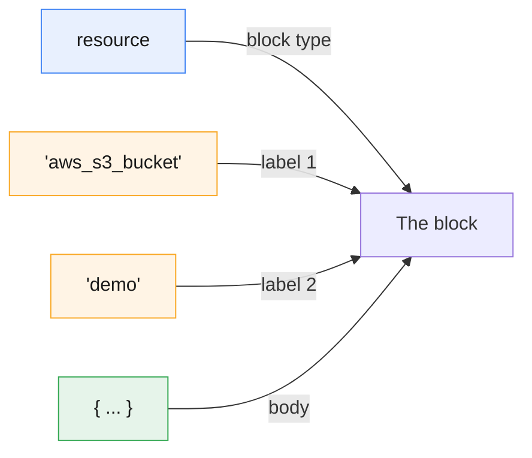
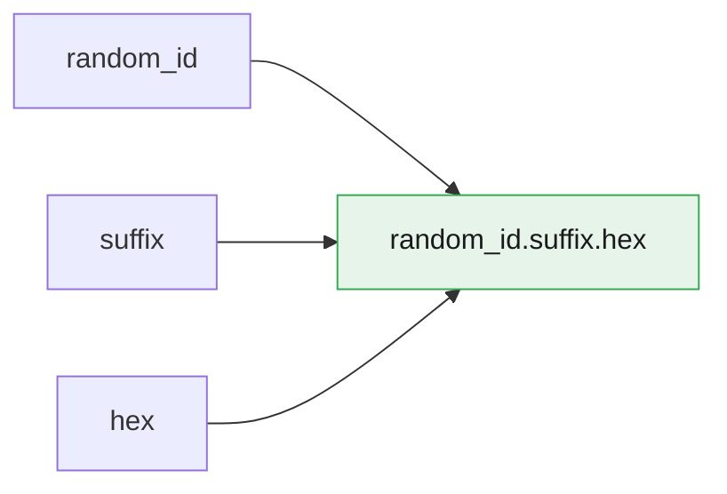

# HCL Syntax Basics

:::info[Continuing from the last guides]
This page continues from **[Terraform Core Commands](./terraform-core-commands)**, **[Terraform Safety Nets](./terraform-tags-safteynets)**, and **[Terraform Providers Explained](./terraform-providers)**. Every example in those pages was written in **HCL** — this page explains the language itself.
:::

:::tip[Start your sandbox here]
👉 **[Launch the official Terraform Sandbox](https://developer.hashicorp.com/terraform/sandbox)** — every example below can be typed directly into a `main.tf` file there.
:::

**HCL** stands for **HashiCorp Configuration Language**. It's the language every `.tf` file is written in. It's built to be easy for humans to read and write, while still being structured enough for Terraform to parse.

---

## 1. The Anatomy of a Block

Every piece of Terraform code is a **block**. You've already been writing them.

```hcl
resource "aws_s3_bucket" "demo" {
  bucket = "my-practice-bucket"
}
```



| Part | In the example | What it means |
|---|---|---|
| **Block type** | `resource` | What kind of thing this is (`resource`, `variable`, `provider`, `output`...) |
| **Labels** | `"aws_s3_bucket"`, `"demo"` | Identify *which* resource type, and *your* nickname for it |
| **Body** | `{ ... }` | Everything inside the curly braces — the actual settings |

:::note[Not every block has 2 labels]
`resource` blocks always have 2 labels (type + name). Other blocks have 1 label (like `variable "region" { ... }`) or none at all (like `provider "aws" { ... }`). The block type decides how many labels it needs.
:::

---

## 2. Arguments — Key = Value

Inside a block's body, you set **arguments**. An argument is just `name = value`.

```hcl
resource "aws_s3_bucket" "demo" {
  bucket = "my-practice-bucket"   # argument: bucket = value
}
```

:::tip[Think of it like filling a form]
The block is the form (e.g., "Create an S3 Bucket"). Each argument is one field on that form you're filling in.
:::

---

## 3. Comments

HCL supports 3 comment styles:

```hcl
# This is a comment (most common style)

// This also works, same as #

/*
  This is a multi-line comment.
  Useful for longer notes.
*/
```

:::tip
Stick to `#` for single-line comments — it's the style you'll see in almost all Terraform code.
:::

---

## 4. Data Types

Every value on the right side of `=` has a type. HCL figures most of these out automatically from how you write them.

| Type | Example | Notes |
|---|---|---|
| **string** | `"us-east-1"` | Always in double quotes |
| **number** | `5`, `3.14` | No quotes |
| **bool** | `true`, `false` | No quotes, lowercase |
| **list** | `["a", "b", "c"]` | Ordered, square brackets |
| **map** | `{ Name = "demo", Env = "sandbox" }` | Key-value pairs, curly braces |
| **null** | `null` | Explicitly "no value" |

### Example using several types together

```hcl
resource "aws_instance" "example" {
  ami           = "ami-0123456789"     # string
  instance_count = 3                   # number
  monitoring    = true                 # bool

  availability_zones = ["us-east-1a", "us-east-1b"]   # list

  tags = {                             # map
    Name        = "practice-instance"
    Environment = "sandbox"
  }
}
```

:::note
You saw this `tags = { ... }` map already in the [Safety Nets guide](./terraform-tags-safteynets) — now you know its official type is a **map**.
:::

---

## 5. String Interpolation — Mixing Text and Values

You'll often need to build a string out of other values. HCL uses `${ ... }` for that:

```hcl
resource "aws_s3_bucket" "demo" {
  bucket = "my-bucket-${var.environment}"
}
```

If `var.environment` is `"dev"`, the real bucket name becomes `"my-bucket-dev"`.

```mermaid
flowchart LR
    A["'my-bucket-&#36;&#123;var.environment&#125;'"] --> B["Terraform evaluates<br/>the &#36;&#123;...&#125; part"]
    B --> C["var.environment = 'dev'"]
    C --> D["Final value:<br/>'my-bucket-dev'"]
 
    style B fill:#fff4e5,stroke:#f9a825,color:#1a1a1a
    style D fill:#e6f4ea,stroke:#34a853,color:#1a1a1a
```



:::warning[Don't over-use it]
If the **entire** value is just one reference (like `bucket = "${var.name}"`), drop the `${}` and write `bucket = var.name` instead. Only use `${}` when you're mixing a reference **into** a larger string, like the example above.
:::

### Multi-line strings (heredoc)

For longer text blocks (like a script or policy document), use `<<EOF ... EOF`:

```hcl
resource "aws_instance" "example" {
  ami           = "ami-0123456789"
  user_data = <<-EOF
              #!/bin/bash
              echo "Hello from Terraform" > /tmp/hello.txt
              EOF
}
```

:::tip
The `-` right after `<<` (as in `<<-EOF`) lets you indent the text to match your code's formatting — Terraform strips the extra leading whitespace automatically.
:::

---

## 6. Expressions — Referencing Other Values

An **expression** is anything that produces a value. The most common expression is a **reference** to something else in your code.

### Referencing a resource's attribute

```hcl
resource "random_id" "suffix" {
  byte_length = 4
}

resource "aws_s3_bucket" "demo" {
  bucket = "my-bucket-${random_id.suffix.hex}"
}
```

The pattern is always: **`<block_type>.<name>.<attribute>`**



### Referencing a variable

```hcl
variable "region" {
  default = "us-east-1"
}

provider "aws" {
  region = var.region
}
```

Variables are always referenced as `var.<name>`.

### Operators

```hcl
locals {
  total       = 2 + 3          # = 5
  is_valid    = 5 > 3          # = true
  full_name   = "web" == "web" # = true
  combined    = "a" + "b"      # ❌ error — use string interpolation instead
}
```

| Operator type | Examples |
|---|---|
| Math | `+`  `-`  `*`  `/`  `%` |
| Comparison | `==`  `!=`  `<`  `>`  `<=`  `>=` |
| Logic | `&&`  (and)  `\|\|`  (or)  `!`  (not) |

### Conditional expression (a simple "if")

```hcl
resource "aws_instance" "example" {
  instance_type = var.environment == "prod" ? "t3.large" : "t3.micro"
}
```

Read it as: **`condition ? value_if_true : value_if_false`**

:::tip[Think of it like a one-line if/else]
"Is environment prod? If yes, use a big instance. If no, use a small one." All in a single line.
:::

---

## 7. `variable` and `locals` — Named Values

### `variable` — an input you (or someone else) provides

```hcl
variable "environment" {
  description = "Which environment this is"
  type        = string
  default     = "sandbox"
}
```

Used elsewhere as `var.environment`.

### `locals` — a named value calculated once, reused everywhere

```hcl
locals {
  bucket_name = "my-bucket-${var.environment}"
}

resource "aws_s3_bucket" "demo" {
  bucket = local.bucket_name
}
```

Used elsewhere as `local.bucket_name`.

:::note[variable vs. locals — what's the difference?]
A **variable** is an input — something that can change from outside (like a setting you pass in). A **local** is just a shortcut you define for yourself, calculated from other values, so you don't repeat the same expression everywhere.
:::

---

## 8. Try It Yourself — Putting It All Together

```hcl
variable "environment" {
  type    = string
  default = "sandbox"
}

locals {
  bucket_name = "hcl-practice-${var.environment}"
}

resource "aws_s3_bucket" "demo" {
  bucket = local.bucket_name

  tags = {
    Environment = var.environment
    ManagedBy   = "terraform"
  }
}

output "final_bucket_name" {
  value = aws_s3_bucket.demo.bucket
}
```

```bash
terraform init
terraform plan
```

```
Plan: 1 to add, 0 to change, 0 to destroy.
```

```bash
terraform apply   # type yes
```

```
Outputs:

final_bucket_name = "hcl-practice-sandbox"
```

```bash
terraform destroy   # type yes, to clean up
```

:::tip
Try changing `default = "sandbox"` to `default = "dev"`, then re-run `terraform plan`. Watch the bucket name change automatically — that's `local.bucket_name` and `${var.environment}` working together.
:::

---

## 9. A Quick Note on JSON

HCL has a JSON-equivalent format (`.tf.json`) that Terraform can also read — useful when a file is generated by another program instead of written by hand.

```json
{
  "resource": {
    "aws_s3_bucket": {
      "demo": {
        "bucket": "my-practice-bucket"
      }
    }
  }
}
```

:::note
You'll rarely write `.tf.json` by hand. It exists mainly for tools that generate Terraform code automatically. Stick to regular `.tf` (HCL) files for anything you write yourself.
:::

---

## Quick Reference

```hcl
# Comment
# Block:        type "label1" "label2" { body }
resource "aws_s3_bucket" "demo" { bucket = "x" }

# Data types
"text"                 # string
42                      # number
true                    # bool
["a", "b"]              # list
{ key = "value" }       # map

# Interpolation
"prefix-${var.name}"

# Reference
resource_type.name.attribute
var.name
local.name

# Conditional
condition ? value_if_true : value_if_false
```

## Cheat Sheet: Which One Do I Need?

| I want to... | Use this |
|---|---|
| Define a reusable input value | `variable "name" { ... }` |
| Calculate a value once and reuse it | `locals { ... }` |
| Mix a value into a larger string | `"text-${var.name}"` |
| Reference another resource's result | `resource_type.name.attribute` |
| Write a longer block of text (like a script) | `<<-EOF ... EOF` |
| Pick between two values based on a condition | `condition ? a : b` |

---

## Summary

- Every `.tf` file is made of **blocks**: a type, optional labels, and a `{ }` body.
- Inside a block, you set **arguments** as `name = value`.
- Values have **types** — string, number, bool, list, map, null — and HCL infers them automatically.
- `${ ... }` mixes a value into a larger string; drop it when the value stands alone.
- **Expressions** let you reference other resources (`type.name.attribute`), variables (`var.name`), and locals (`local.name`).
- `variable` blocks define inputs; `locals` blocks define reusable calculated values.
- `.tf.json` is a machine-friendly equivalent of HCL, rarely written by hand.