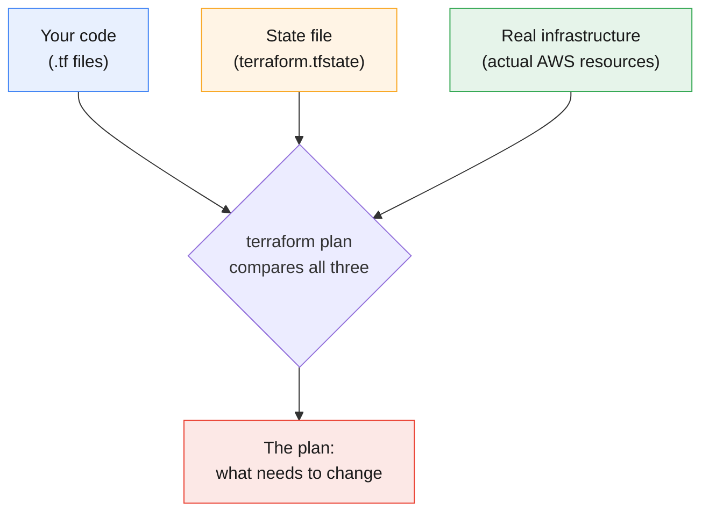
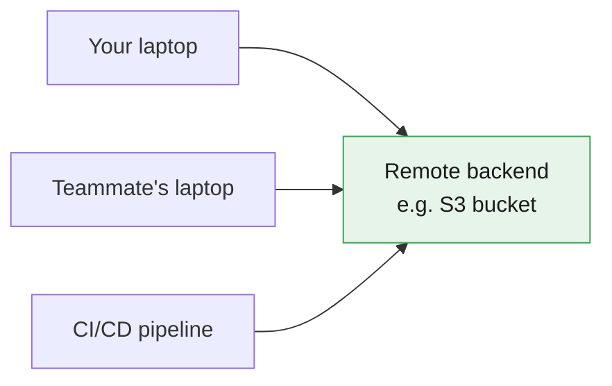
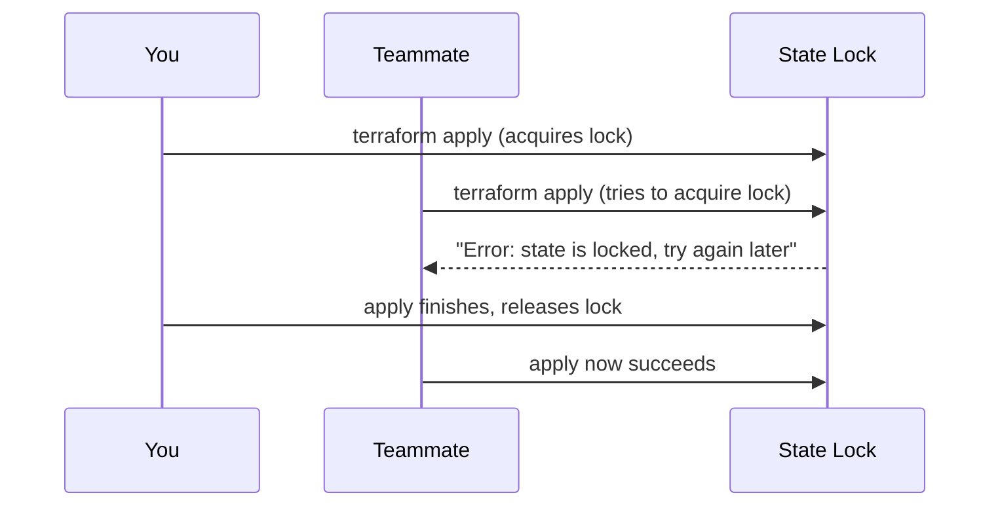
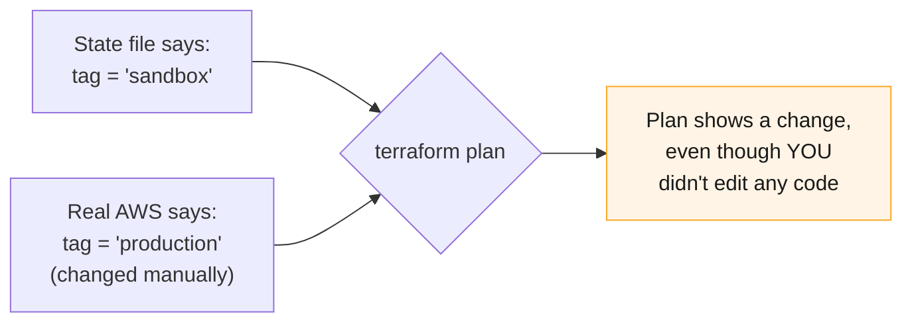

# Terraform State Explained

:::info[Continuing from the last guides]
This page continues from **[Terraform Core Commands](./terraform-core-commands)**, **[Terraform Safety Nets](./terraform-tags-safteynets)**, **[Terraform Providers Explained](./terraform-providers)**, and **[HCL Syntax Basics](./hcl-syntax)**. Every `terraform plan` and `terraform apply` you've run so far has been quietly reading and writing something called **state** — this page explains exactly what that is.
:::

:::tip[Start your sandbox here]
👉 **[Launch the official Terraform Sandbox](https://developer.hashicorp.com/terraform/sandbox)** — every example below can be typed directly into a `main.tf` file there.
:::

---

## 1. What Is State?

**State** is a file where Terraform keeps track of what it has already created. It's Terraform's memory.

Without state, every time you ran `terraform plan`, Terraform would have no idea whether your bucket already exists — it would just see your code and AWS, with nothing connecting the two.

:::tip[Think of it like a receipt]
When you buy something, the receipt proves what you bought, when, and for how much. Terraform's state file is that receipt — proof of what it already built, so it never buys the same thing twice.
:::

By default, this file is called **`terraform.tfstate`**, and it's created automatically the first time you run `terraform apply`.

---

## 2. Why State Matters — The 3-Way Comparison

Every time you run `terraform plan`, Terraform is quietly comparing **three** things, not two:



| Source | What it represents |
|---|---|
| **Your code** | What you *want* to exist |
| **State file** | What Terraform *believes* already exists |
| **Real infrastructure** | What *actually* exists in AWS |

:::note
This is exactly why `terraform plan` can tell you "1 to add, 0 to change" — it's not guessing. It's comparing your code against the state file, and double-checking against real AWS.
:::

---

## 3. Where State Lives: Local vs. Remote

### Local state (the default)

When you don't configure anything special, Terraform just saves `terraform.tfstate` as a plain file in your project folder.

```bash
terraform apply    # type yes
ls
```

```
main.tf
terraform.tfstate
terraform.tfstate.backup
```

:::warning[Never commit terraform.tfstate to Git]
The state file often contains **sensitive values in plain text** — passwords, keys, connection strings, anything Terraform manages. Add it to `.gitignore`:
```
terraform.tfstate
terraform.tfstate.backup
```
:::

### `terraform.tfstate.backup`

Terraform automatically saves a copy of your **previous** state file before writing a new one, just in case something goes wrong mid-apply.

:::tip
Think of `.backup` as an "undo" snapshot — you shouldn't need it often, but it's there if a state file ever gets corrupted.
:::

### Remote state (the real-world default)

For any team project, state is stored in a shared, remote location instead — so everyone (and your CI pipeline) reads and writes the **same** state file.

```hcl
terraform {
  backend "s3" {
    bucket = "my-terraform-state-bucket"
    key    = "practice/terraform.tfstate"
    region = "us-east-1"
  }
}
```



:::info
A **backend** is just Terraform's term for "where state is stored." `local` (the default) and `s3` are both backends — there are others too (Azure Storage, Google Cloud Storage, Terraform Cloud).
:::

---

## 4. State Locking — Preventing Two People from Colliding

If two people run `terraform apply` on the same project **at the same time**, they could both try to write to the state file at once and corrupt it. **Locking** prevents that.



With a remote backend like S3 (paired with DynamoDB for locking), this happens automatically. If someone else is applying, you'll see:

```
Error: Error acquiring the state lock

Lock Info:
  ID:        d1b2c3...
  Who:       teammate@laptop
  Operation: OperationTypeApply
```

:::note
This is a safety feature, not a bug. Wait for the lock to release, or check with your teammate before force-unlocking anything.
:::

---

## 5. Peeking Inside the State File

The state file is plain JSON. You normally don't edit it directly, but it helps to see what's inside once:

```bash
cat terraform.tfstate
```

```json
{
  "version": 4,
  "resources": [
    {
      "type": "aws_s3_bucket",
      "name": "demo",
      "instances": [
        {
          "attributes": {
            "id": "my-practice-bucket",
            "bucket": "my-practice-bucket",
            "region": "us-east-1"
          }
        }
      ]
    }
  ]
}
```

:::danger[Never hand-edit the state file]
Manually changing `terraform.tfstate` can easily corrupt it or make it disagree with real infrastructure. Always use the `terraform state ...` commands below instead — they update the file safely.
:::

---

## 6. Safe State Commands

All of these commands read or update state **safely** — no manual editing required.

### `terraform state list` — see everything Terraform is tracking

```bash
terraform state list
```

```
aws_s3_bucket.demo
random_id.suffix
```

### `terraform state show` — see one resource's full details

```bash
terraform state show aws_s3_bucket.demo
```

```
# aws_s3_bucket.demo:
resource "aws_s3_bucket" "demo" {
    bucket = "my-practice-bucket"
    region = "us-east-1"
    id     = "my-practice-bucket"
}
```

### `terraform state mv` — rename without destroying

You already saw this one in the [Safety Nets guide](./terraform-tags-safteynets) — it renames a resource inside state without touching the real infrastructure.

```bash
terraform state mv aws_s3_bucket.demo aws_s3_bucket.main
```

### `terraform state rm` — stop tracking, without deleting

This tells Terraform to **forget** about a resource — the real resource in AWS is untouched, but Terraform will no longer manage it.

```bash
terraform state rm aws_s3_bucket.demo
```

```
Removed aws_s3_bucket.demo
Successfully removed 1 resource instance(s).
```

:::tip[When would I use this?]
If you're handing a resource off to be managed some other way (manually, or by a different Terraform project), `state rm` lets you stop managing it cleanly — without deleting the actual bucket.
:::

### `terraform import` — start tracking something that already exists

The opposite problem: you have a real AWS resource that was created *outside* Terraform (by hand, or by another tool), and now you want Terraform to manage it.

```bash
terraform import aws_s3_bucket.demo my-existing-bucket-name
```

```
aws_s3_bucket.demo: Importing from ID "my-existing-bucket-name"...
aws_s3_bucket.demo: Import complete!

Import successful!
```

:::warning
`import` only adds the resource to **state** — it does not write the matching `resource` block in your `.tf` code for you. You still need to write that block yourself so future `plan` runs don't try to destroy the resource you just imported.
:::

---

## 7. Drift — When Reality Changes Outside Terraform

**Drift** happens when someone changes a real resource outside of Terraform — for example, manually editing a bucket's tags in the AWS Console. Now the state file and real infrastructure disagree.



### Try it yourself

1. Apply a bucket with a tag, e.g. `Environment = "sandbox"`.
```hcl
resource "aws_s3_bucket" "demo" {
  bucket = "state-practice-bucket"

  tags = {
    Environment = "sandbox"
  }
}
```
2. Manually change that tag using the AWS CLI (or console, if available in your sandbox):
   ```bash
   aws s3api put-bucket-tagging --bucket state-practice-bucket --tagging 'TagSet=[{Key=Environment,Value=production}]'
   ```
3. Run `terraform plan` again — Terraform detects the drift and offers to change it back to match your code.

:::note
This is expected behavior, not an error. `plan` always trusts your `.tf` code as the source of truth, and will offer to correct anything that drifted away from it.
:::

### `terraform apply -refresh-only` — just update state, don't change anything

If the drifted value is actually fine, and you want state to simply catch up to reality (instead of reverting it), use:

```bash
terraform apply -refresh-only
```

This updates the state file to match real infrastructure, without touching AWS at all.

---

## 8. Try It Yourself — Full Walkthrough

```hcl
resource "aws_s3_bucket" "demo" {
  bucket = "state-practice-bucket"

  tags = {
    Environment = "sandbox"
  }
}
```

```bash
terraform init
terraform apply              # type yes

terraform state list         # see it tracked
terraform state show aws_s3_bucket.demo   # see its details

terraform state mv aws_s3_bucket.demo aws_s3_bucket.main
# update main.tf's resource name to "main" too, then:
terraform plan                # should say "No changes"

terraform destroy             # type yes, to clean up
```

---

## Quick Reference

```bash
# See everything Terraform is tracking
terraform state list

# See one resource's full details
terraform state show <resource>

# Rename a resource in state (no real change)
terraform state mv <old_name> <new_name>

# Stop tracking a resource (does NOT delete it)
terraform state rm <resource>

# Start tracking something that already exists
terraform import <resource> <real_id>

# Update state to match reality, without changing anything
terraform apply -refresh-only
```

## Cheat Sheet: Which One Do I Need?

| I want to... | Use this |
|---|---|
| See what Terraform is currently managing | `terraform state list` |
| See full details of one tracked resource | `terraform state show` |
| Rename a resource without recreating it | `terraform state mv` |
| Stop managing a resource, keep it in AWS | `terraform state rm` |
| Bring an existing AWS resource under Terraform | `terraform import` |
| Store state somewhere shared, not just my laptop | Configure a `backend` (e.g. `s3`) |
| Stop two people applying at the same time | State locking (automatic with most remote backends) |
| Sync state after a manual change outside Terraform | `terraform apply -refresh-only` |

---

## Summary

- **State** (`terraform.tfstate`) is how Terraform remembers what it already created — without it, every `plan` would be blind.
- `terraform plan` always compares **3 things**: your code, the state file, and real infrastructure.
- State can live **locally** (a file on your laptop) or **remotely** (a shared backend like S3) — remote is the standard for any team.
- **Never commit `terraform.tfstate` to Git** — it can contain secrets in plain text.
- **Never hand-edit the state file** — use the `terraform state` commands instead.
- **Locking** stops two people from writing to state at the same time and corrupting it.
- **Drift** is when reality changes outside Terraform — `plan` will detect and report it.
- `terraform import` brings existing resources under Terraform's management; `terraform state rm` releases them again without deleting anything real.