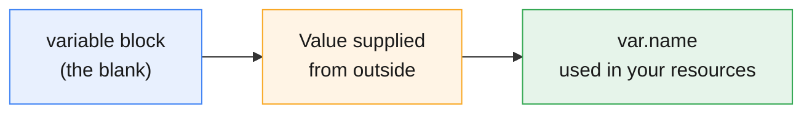
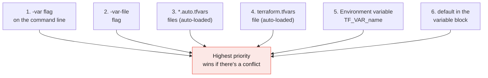

# Terraform Input Variables

:::info[Continuing from the last guides]
This page continues from **[Terraform Core Commands](./terraform-core-commands)**, **[Terraform Safety Nets](./terraform-tags-safteynets)**, **[Terraform Providers Explained](./terraform-providers)**, **[HCL Syntax Basics](./hcl-syntax)**, and **[Terraform State Explained](./terraform-state)**. You already saw a basic `variable` block in the HCL guide — this page covers everything about them.
:::

:::tip[Start your sandbox here]
👉 **[Launch the official Terraform Sandbox](https://developer.hashicorp.com/terraform/sandbox)** — every example below can be typed directly into a `main.tf` file there.
:::

---

## 1. What Is an Input Variable?

An **input variable** is a value your Terraform code needs, but doesn't hardcode — it's filled in from outside. This makes the same code reusable across environments (dev, staging, prod) without editing it every time.

:::tip[Think of it like a form field]
Your `.tf` code is a form with blanks in it. A variable is one of those blanks — like "Region: ______." You (or a pipeline, or a teammate) fill it in before Terraform runs.
:::



---

## 2. Declaring a Variable

```hcl
variable "region" {
  description = "AWS region to deploy into"
  type        = string
  default     = "us-east-1"
}
```

| Argument | Required? | What it does |
|---|---|---|
| `description` | Optional, but always recommend it | Explains the variable to anyone reading your code |
| `type` | Optional, but always recommend it | Restricts what kind of value is allowed |
| `default` | Optional | The value used if nobody supplies one |

### Using it

```hcl
provider "aws" {
  region = var.region
}
```

:::note
Always reference a variable as `var.<name>` — never just `<name>` by itself.
:::

---

## 3. Types

| Type | Example value | Notes |
|---|---|---|
| `string` | `"us-east-1"` | Text |
| `number` | `3`, `2.5` | No quotes |
| `bool` | `true` / `false` | No quotes |
| `list(string)` | `["a", "b", "c"]` | Ordered, same type inside |
| `map(string)` | `{ dev = "t2.micro", prod = "t3.large" }` | Key-value pairs |
| `object({...})` | see below | A fixed structure with named fields |
| `any` | anything | No restriction — use sparingly |

### Simple example: `list`

```hcl
variable "availability_zones" {
  type    = list(string)
  default = ["us-east-1a", "us-east-1b"]
}
```

### Simple example: `map`

```hcl
variable "instance_sizes" {
  type = map(string)
  default = {
    dev  = "t2.micro"
    prod = "t3.large"
  }
}
```

Used as `var.instance_sizes["dev"]`.

### A more structured example: `object`

```hcl
variable "server_config" {
  type = object({
    name = string
    size = string
    ha   = bool
  })

  default = {
    name = "web-server"
    size = "t2.micro"
    ha   = false
  }
}
```

Used as `var.server_config.name`, `var.server_config.size`, etc.

:::tip[When should I use object instead of separate variables?]
Use `object` when a group of values always travels together and belongs to one "thing" — like one server's name, size, and settings — instead of declaring three unrelated top-level variables.
:::

---

## 4. The 5 Ways to Set a Variable's Value

You never have to hardcode a value. Terraform will look in several places, in a specific order.



:::note[Precedence, simply]
Command-line flags beat files, files beat environment variables, and everything beats the `default` — the `default` is only used as a last resort, if nothing else supplied a value.
:::

### Way 1 — Command line, one at a time

```bash
terraform apply -var="region=us-west-2"
```

### Way 2 — A `.tfvars` file, loaded manually

`prod.tfvars`:
```hcl
region = "us-west-2"
```

```bash
terraform apply -var-file="prod.tfvars"
```

### Way 3 — `terraform.tfvars`, loaded automatically

If a file is literally named `terraform.tfvars`, Terraform loads it **automatically** — no flag needed.

```hcl
# terraform.tfvars
region = "us-west-2"
```

```bash
terraform apply    # picks up terraform.tfvars automatically
```

### Way 4 — `*.auto.tfvars`, also loaded automatically

Any file ending in `.auto.tfvars` is also loaded automatically — useful when you want multiple, clearly-named files.

```
dev.auto.tfvars
network.auto.tfvars
```

### Way 5 — Environment variables

```bash
export TF_VAR_region="us-west-2"
terraform apply
```

:::tip
The environment variable name is always `TF_VAR_` followed by the exact variable name — `TF_VAR_region` sets `var.region`.
:::

### Way 6 — The `default` in the variable block

If none of the above are set, Terraform falls back to whatever `default` you wrote in the `variable` block.

### What if there's no default and nothing was supplied?

Terraform will pause and **ask you interactively**:

```
var.region
  AWS region to deploy into

  Enter a value:
```

:::warning
This is fine for manual practice, but a problem in automation (like CI/CD), where nobody is there to type an answer. Always supply a value some other way when running Terraform non-interactively.
:::

---

## 5. Validation — Catching Bad Input Early

You can add rules so Terraform rejects an invalid value **before** it even tries to `plan`.

```hcl
variable "environment" {
  type = string

  validation {
    condition     = contains(["dev", "staging", "prod"], var.environment)
    error_message = "environment must be one of: dev, staging, prod."
  }
}
```

```bash
terraform apply -var="environment=test"
```

```
│ Error: Invalid value for variable

│ environment must be one of: dev, staging, prod.
```

:::tip[Think of it like a form's error message]
Just like a signup form telling you "password must be 8+ characters" before you can submit, `validation` stops bad values from ever reaching your infrastructure.
:::

---

## 6. Sensitive Variables

If a variable holds something secret (a password, an API key), mark it `sensitive` so Terraform hides it from `plan`/`apply` output and logs.

```hcl
variable "db_password" {
  type      = string
  sensitive = true
}
```

```bash
terraform plan
```

```
  # aws_db_instance.demo will be created
  + resource "aws_db_instance" "demo" {
      + password = (sensitive value)
    }
```

:::warning
`sensitive = true` hides the value from **output**, but it's still saved in plain text inside the state file. Combine it with a remote backend and restricted access to state, as covered in the [State guide](./terraform-state#local-state-the-default).
:::

---

## 7. Required vs. Optional Variables

| If you write... | The variable is... |
|---|---|
| `type` + `default` | **Optional** — falls back to default if nothing is supplied |
| `type` only, no `default` | **Required** — Terraform will prompt or error if it's missing |

```hcl
variable "bucket_name" {
  type        = string
  description = "Must be supplied — no default given"
  # no default = required
}
```
In Terraform, a variable is required when you define its `type` but do not provide a `default` value, which means you must supply a value when running Terraform. For example, variable `"bucket_name" { type = string }` means Terraform expects you to provide the bucket name. If you add `default = "my-bucket"`, the variable becomes optional because Terraform will automatically use "my-bucket" when you don't provide another value.

---

## 8. Try It Yourself — Full Example

```hcl
variable "environment" {
  type    = string
  default = "sandbox"

  validation {
    condition     = contains(["sandbox", "dev", "prod"], var.environment)
    error_message = "environment must be sandbox, dev, or prod."
  }
}

variable "bucket_prefix" {
  type        = string
  description = "Prefix for the bucket name"
  default     = "var-practice"
}

resource "aws_s3_bucket" "demo" {
  bucket = "${var.bucket_prefix}-${var.environment}"

  tags = {
    Environment = var.environment
  }
}

output "bucket_name" {
  value = aws_s3_bucket.demo.bucket
}
```

```bash
terraform init
terraform plan
```

```
Plan: 1 to add, 0 to change, 0 to destroy.
```

```bash
terraform apply -var="environment=dev"    # type yes
```

```
Outputs:

bucket_name = "var-practice-dev"
```

```bash
terraform destroy -var="environment=dev"    # type yes, to clean up
```

:::tip
Try running `terraform apply -var="environment=test"` — watch the `validation` block stop it before anything gets created.
:::

---

## Quick Reference

```bash
# Set a variable on the command line
terraform apply -var="region=us-west-2"

# Load a specific file of variables
terraform apply -var-file="prod.tfvars"

# Automatically loaded, no flag needed
terraform.tfvars
*.auto.tfvars

# Environment variable
export TF_VAR_region="us-west-2"
```

```hcl
# Declare a variable
variable "name" {
  type        = string
  description = "What this is for"
  default     = "value"       # omit to make it required
  sensitive   = true            # omit unless it's a secret

  validation {
    condition     = <expression using var.name>
    error_message = "..."
  }
}

# Use it
var.name
```

## Cheat Sheet: Which One Do I Need?

| I want to... | Use this |
|---|---|
| Give a variable a fallback value | `default` in the `variable` block |
| Force the variable to always be supplied | Leave out `default` |
| Restrict what values are allowed | `type` |
| Add a custom rule beyond just type | `validation` block |
| Hide a value from plan/apply output | `sensitive = true` |
| Set a value quickly for one run | `-var="name=value"` |
| Keep values in a reusable file | `.tfvars` file with `-var-file` |
| Set values without any file or flag | `terraform.tfvars` or `*.auto.tfvars` |
| Set a value from a script or CI pipeline | `TF_VAR_name` environment variable |

---

## Summary

- An **input variable** is a value your code needs, supplied from outside instead of hardcoded — always referenced as `var.<name>`.
- `type` restricts what values are allowed; `description` documents what it's for; `default` provides a fallback.
- There are **6 ways** to set a value, and the highest-priority one wins: `-var` flag → `-var-file` → `*.auto.tfvars` → `terraform.tfvars` → `TF_VAR_` env variable → `default`.
- A variable with **no `default`** is required — Terraform will prompt for it, or error out in non-interactive runs like CI/CD.
- `validation` blocks reject bad values before anything gets planned or applied.
- `sensitive = true` hides a value from CLI output, but it's still stored in plain text in state — protect your state file too.