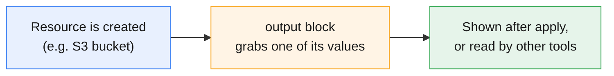
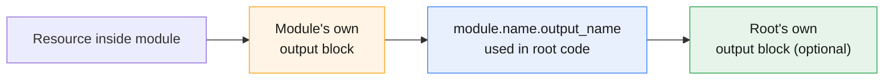
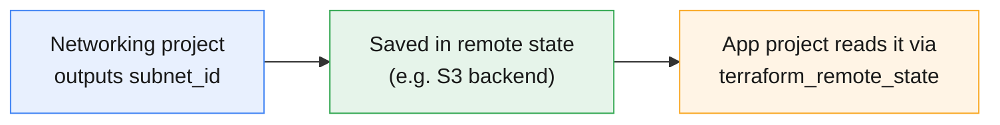

# Terraform Outputs

:::info[Continuing from the last guides]
This page continues from **[Terraform Core Commands](./terraform-core-commands)**, **[Terraform Safety Nets](./terraform-tags-safteynets)**, **[Terraform Providers Explained](./terraform-providers)**, **[HCL Syntax Basics](./hcl-syntax)**, **[Terraform State Explained](./terraform-state)**, and **[Terraform Input Variables](./terraform-input-variables)**. Variables get values **in** — outputs send values **out**. This page covers outputs.
:::

:::tip[Start your sandbox here]
👉 **[Launch the official Terraform Sandbox](https://developer.hashicorp.com/terraform/sandbox)** — every example below can be typed directly into a `main.tf` file there.
:::

---

## 1. What Is an Output?

An **output** is a value Terraform prints after `apply` — usually something you (or another tool, or another Terraform project) needs afterward, like a bucket name, an IP address, or a generated ID.

:::tip[Think of it like a receipt printout]
After you check out at a store, the receipt shows you what you actually got — item names, final prices. An output is Terraform's receipt: after it builds something, it hands you back the details you'll actually need.
:::



---

## 2. Declaring an Output

```hcl
resource "aws_s3_bucket" "demo" {
  bucket = "my-practice-bucket"
}

output "bucket_name" {
  description = "The name of the created bucket"
  value       = aws_s3_bucket.demo.bucket
}
```

| Argument | Required? | What it does |
|---|---|---|
| `value` | **Required** | The actual value to expose — usually a reference to a resource's attribute |
| `description` | Optional, but recommended | Explains what this output is, for anyone reading your code |
| `sensitive` | Optional | Hides the value from CLI output (see Section 5) |

### What you'll see

```bash
terraform apply
```

```
aws_s3_bucket.demo: Creating...
aws_s3_bucket.demo: Creation complete after 2s

Apply complete! Resources: 1 added, 0 changed, 0 destroyed.

Outputs:

bucket_name = "my-practice-bucket"
```

:::note
Outputs are printed automatically at the end of every `apply` — you don't need to ask for them separately at that point.
:::

---

## 3. Viewing Outputs Later — `terraform output`

You don't have to re-run `apply` just to see outputs again. Use:

```bash
terraform output
```

```
bucket_name = "my-practice-bucket"
```

### Get just one output's raw value

```bash
terraform output bucket_name
```

```
"my-practice-bucket"
```

:::tip
Add `-raw` to get the value **without** quotes — useful when piping it into a script:
```bash
terraform output -raw bucket_name
```
```
my-practice-bucket
```
:::

### Get all outputs as JSON — useful for scripts

```bash
terraform output -json
```

```json
{
  "bucket_name": {
    "sensitive": false,
    "type": "string",
    "value": "my-practice-bucket"
  }
}
```

:::note
`-json` is what most automation scripts and CI pipelines use to read Terraform's outputs programmatically, instead of parsing plain text.
:::

---

## 4. Outputting More Than One Value

You can declare as many `output` blocks as you need — one per value you care about.

```hcl
resource "aws_s3_bucket" "demo" {
  bucket = "my-practice-bucket"
}

output "bucket_name" {
  value = aws_s3_bucket.demo.bucket
}

output "bucket_arn" {
  value = aws_s3_bucket.demo.arn
}

output "bucket_region" {
  value = aws_s3_bucket.demo.region
}
```

```bash
terraform output
```

```
bucket_arn    = "arn:aws:s3:::my-practice-bucket"
bucket_name   = "my-practice-bucket"
bucket_region = "us-east-1"
```

### Outputs can also be lists, maps, or objects

```hcl
output "all_buckets" {
  value = [aws_s3_bucket.demo.bucket, aws_s3_bucket.backup.bucket]
}

output "bucket_details" {
  value = {
    name   = aws_s3_bucket.demo.bucket
    region = aws_s3_bucket.demo.region
  }
}
```

---

## 5. Sensitive Outputs

If an output holds something secret (like a generated database password), mark it `sensitive` so it's hidden from the CLI.

```hcl
output "db_password" {
  value     = aws_db_instance.demo.password
  sensitive = true
}
```

```bash
terraform apply
```

```
Outputs:

db_password = <sensitive>
```

### Reading it anyway, when you actually need it

```bash
terraform output db_password
```

```
"S3cr3tPassw0rd!"
```

:::warning
`sensitive = true` only hides the value from normal CLI output — running `terraform output <name>` directly, or `-json`, still reveals it. It's also stored in plain text in the state file, just like [sensitive variables](./terraform-input-variables) are. Protect your state file (see the [State guide](./terraform-state)) as the real safeguard.
:::

---

## 6. Outputs From Modules

If your resource lives inside a **module** (a reusable folder of `.tf` files), the module needs its own `output` block to expose a value — otherwise, nothing outside the module can see it.

**Inside the module** (`modules/bucket/main.tf`):
```hcl
resource "aws_s3_bucket" "this" {
  bucket = var.bucket_name
}

output "bucket_name" {
  value = aws_s3_bucket.this.bucket
}
```

**In your root `main.tf`, calling the module:**
```hcl
module "my_bucket" {
  source      = "./modules/bucket"
  bucket_name = "module-practice-bucket"
}

output "final_bucket_name" {
  value = module.my_bucket.bucket_name
}
```



:::note
The pattern is always **`module.<module_name>.<output_name>`** — very similar to how you reference a resource's attribute.
:::

A **module** is like a separate folder that contains our Terraform resources. In our example, inside the `modules/bucket` module, we created an S3 bucket named `aws_s3_bucket.this` using the bucket name provided through `var.bucket_name`. Since the S3 bucket is inside the module, the root `main.tf` cannot directly access `aws_s3_bucket.this.bucket`. So, inside the module, we created an **output** named `bucket_name` that exposes the bucket's actual name using `value = aws_s3_bucket.this.bucket`. Then, in the root `main.tf`, we called this module with the name `my_bucket` using `module "my_bucket"`. Because the module's output is called `bucket_name`, we can access it from the root using **`module.my_bucket.bucket_name`**. Finally, we created a root output called `final_bucket_name` to display that value. In simple terms: **`aws_s3_bucket.this.bucket` → module output `bucket_name` → root accesses it as `module.my_bucket.bucket_name` → root output `final_bucket_name`.**

Yes — **`bucket_name = "module-practice-bucket"` is already giving the bucket name to the module.** The confusing part is that there are **two different directions of data flow**.

```text
ROOT main.tf
   |
   | bucket_name = "module-practice-bucket"
   ↓
MODULE "my_bucket"
   |
   | var.bucket_name
   ↓
S3 Bucket: aws_s3_bucket.this
   |
   | output "bucket_name"
   ↓
ROOT main.tf
   |
   | module.my_bucket.bucket_name
   ↓
final_bucket_name
```

In the root `main.tf`, `bucket_name = "module-practice-bucket"` **sends the value into the module** and the module receives it as `var.bucket_name`. The module then uses that value to create the S3 bucket `aws_s3_bucket.this`. After creating the bucket, the module's `output "bucket_name"` **sends the bucket name back out of the module**. The root code accesses that returned value using `module.my_bucket.bucket_name`, and assigns it to the root output `final_bucket_name`. Therefore, the **final output value will be `module-practice-bucket`**.

So remember:

**Input → Root sends value INTO module**

```hcl
bucket_name = "module-practice-bucket"
```

**Output → Module sends value BACK to root**

```hcl
module.my_bucket.bucket_name
```

The output is not creating another bucket or another name. **It is just exposing the bucket's existing name so the root module can use or display it.**


---

## 7. Sharing Outputs Between Separate Projects — Remote State

Sometimes two **completely separate** Terraform projects need to share a value — for example, a "networking" project creates a VPC, and an "app" project needs that VPC's ID. Since they're different projects, you can't just write `var.vpc_id` — instead, the app project reads the networking project's **state** directly.

```hcl
data "terraform_remote_state" "network" {
  backend = "s3"

  config = {
    bucket = "my-terraform-state-bucket"
    key    = "network/terraform.tfstate"
    region = "us-east-1"
  }
}

resource "aws_instance" "app" {
  subnet_id = data.terraform_remote_state.network.outputs.subnet_id
}
```



:::tip
This only works for a value that the *other* project already exposed as an `output`. If it wasn't declared as an output there, it isn't visible here — outputs are the only "public" values a Terraform project shares.
:::

---

## 8. Try It Yourself — Full Example

```hcl
resource "random_id" "suffix" {
  byte_length = 4
}

resource "aws_s3_bucket" "demo" {
  bucket = "output-practice-${random_id.suffix.hex}"

  tags = {
    Environment = "sandbox"
  }
}

output "bucket_name" {
  description = "Name of the practice bucket"
  value       = aws_s3_bucket.demo.bucket
}

output "bucket_tags" {
  value = aws_s3_bucket.demo.tags
}
```

```bash
terraform init
terraform apply    # type yes
```

```
Outputs:

bucket_name = "output-practice-a1b2c3d4"
bucket_tags = {
  "Environment" = "sandbox"
}
```

```bash
terraform output bucket_name
terraform output -raw bucket_name
terraform output -json
```

```bash
terraform destroy    # type yes, to clean up
```

:::tip
Try adding `sensitive = true` to `bucket_name`, re-apply, and compare what `terraform apply` prints vs. what `terraform output bucket_name` prints directly.
:::

---

## Quick Reference

```bash
# See all outputs
terraform output

# See one output's value
terraform output bucket_name

# See one output without quotes (good for scripts)
terraform output -raw bucket_name

# See all outputs as JSON
terraform output -json
```

```hcl
# Declare an output
output "name" {
  description = "What this is"
  value       = resource_type.name.attribute
  sensitive   = true          # omit unless it's a secret
}

# Reference a module's output
module.module_name.output_name

# Read another project's output via its state
data "terraform_remote_state" "name" {
  backend = "s3"
  config  = { ... }
}
data.terraform_remote_state.name.outputs.output_name
```

## Cheat Sheet: Which One Do I Need?

| I want to... | Use this |
|---|---|
| Show a value after `apply` finishes | `output` block |
| Re-check outputs without re-applying | `terraform output` |
| Get one output's plain value, no quotes | `terraform output -raw <name>` |
| Feed outputs into a script or CI pipeline | `terraform output -json` |
| Hide a secret value from normal output | `sensitive = true` |
| Expose a value from inside a module | `output` block inside the module |
| Use a module's output in the root config | `module.<name>.<output_name>` |
| Share a value with a completely separate project | `terraform_remote_state` data source |

---

## Summary

- An **output** exposes a value after `apply` — usually a resource's attribute, like a bucket name or ARN.
- `terraform output` shows them anytime, without re-applying; `-raw` strips quotes, `-json` is for scripts.
- Outputs can be strings, lists, maps, or objects — not just plain text.
- `sensitive = true` hides a value from normal CLI printing, but it's still readable with `terraform output <name>` and still stored in plain text in state.
- A **module** needs its own `output` blocks to expose values — read from the root as `module.<name>.<output_name>`.
- Two **separate** Terraform projects share values through the `terraform_remote_state` data source, which reads another project's outputs from its state file.