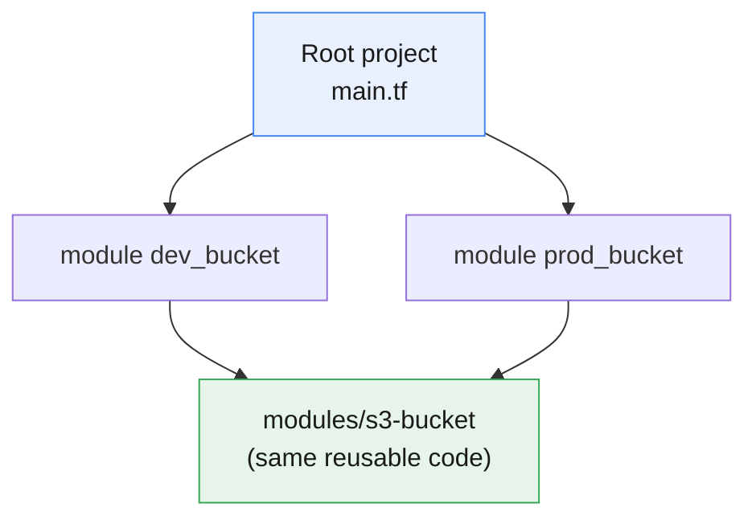
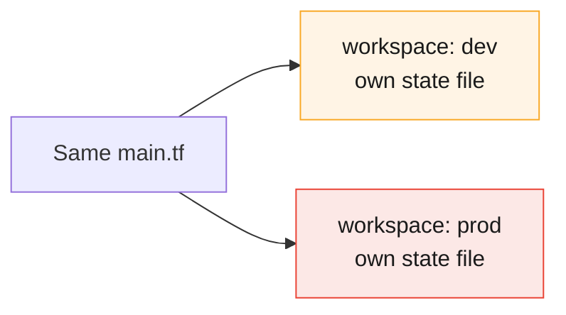

# Terraform Project Structure

:::info[Continuing from the last guides]
This page continues from **[Terraform Core Commands](./terraform-core-commands)**, **[Terraform Safety Nets](./terraform-tags-safteynets)**, **[Terraform Providers Explained](./terraform-providers)**, **[HCL Syntax Basics](./hcl-syntax)**, **[Terraform State Explained](./terraform-state)**, **[Terraform Input Variables](./terraform-input-variables)**, and **[Terraform Outputs](./terraform-outputs)**. So far every example lived in one `main.tf`. This page shows how real projects organize many files and folders.
:::

:::tip[Start your sandbox here]
👉 **[Launch the official Terraform Sandbox](https://developer.hashicorp.com/terraform/sandbox)** — every example below can be typed directly into files there.
:::

---

## 1. Why Structure Matters

Terraform doesn't actually care what you name your files — it reads **every** `.tf` file in a folder and treats them as one combined project. Splitting files up is purely for **humans**: so anyone opening the project can find things quickly.

:::tip[Think of it like organizing a kitchen]
You could keep every utensil in one giant drawer, and it would still technically work. But a labeled drawer for spoons, one for knives, one for pans makes life easier for anyone using the kitchen — including future you.
:::

---

## 2. Standard File Names (Single Project)

Even a small project benefits from splitting into a few conventional files:

```
my-project/
├── main.tf          # Your primary resources
├── variables.tf      # All "variable" blocks
├── outputs.tf         # All "output" blocks
├── providers.tf        # provider blocks + required_providers
├── terraform.tfvars      # Actual values for your variables
└── .gitignore
```

| File | What goes in it |
|---|---|
| `main.tf` | The actual `resource` blocks — the "stuff" being built |
| `variables.tf` | Every `variable` block, so all inputs are in one place |
| `outputs.tf` | Every `output` block, so all exposed values are in one place |
| `providers.tf` | `terraform { required_providers { ... } }` and `provider "..." { ... }` blocks |
| `terraform.tfvars` | The actual values for your variables (see the [Variables guide](./terraform-input-variables)) |

:::note
None of these names are enforced by Terraform — `variables.tf` isn't special to Terraform itself. It's just the convention almost everyone follows, which is exactly why you should follow it too: anyone opening your project already knows where to look.
:::

### Try it yourself

```bash
mkdir my-project && cd my-project
--------------------------------------------
cat > providers.tf <<'EOF'
terraform {
  required_providers {
    aws = {
      source  = "hashicorp/aws"
      version = "~> 5.0"
    }
  }
}

provider "aws" {
  region     = var.region
  access_key = "test"
  secret_key = "test"

  s3_use_path_style           = true
  skip_credentials_validation = true
  skip_metadata_api_check     = true
  skip_requesting_account_id  = true

  endpoints {
    s3 = "http://localhost:4566"
  }
}
EOF
--------------------------------------------
cat > variables.tf <<'EOF'
variable "region" {
  type    = string
  default = "us-east-1"
}
EOF
--------------------------------------------
cat > main.tf <<'EOF'
resource "aws_s3_bucket" "demo" {
  bucket = "structure-practice-bucket"
}
EOF
--------------------------------------------
cat > outputs.tf <<'EOF'
output "bucket_name" {
  value = aws_s3_bucket.demo.bucket
}
EOF
--------------------------------------------
terraform init
terraform apply    # type yes
```

:::tip
Notice you didn't have to tell Terraform which file holds what — it reads all `.tf` files in the folder as one project automatically.
:::

---

## 3. Growing Up: Adding Modules

Once a piece of your code gets reused (like "an S3 bucket with standard tags"), pull it into its own **module** — a subfolder with its own `.tf` files.

```
my-project/
├── main.tf
├── variables.tf
├── outputs.tf
├── providers.tf
└── modules/
    └── s3-bucket/
        ├── main.tf        # the reusable resource(s)
        ├── variables.tf    # inputs the module accepts
        └── outputs.tf       # values the module exposes
```

**Inside `modules/s3-bucket/main.tf`:**
```hcl
resource "aws_s3_bucket" "this" {
  bucket = var.bucket_name

  tags = {
    Environment = var.environment
  }
}
```

**Inside `modules/s3-bucket/variables.tf`:**
```hcl
variable "bucket_name" {
  type = string
}

variable "environment" {
  type = string
}
```

**Inside `modules/s3-bucket/outputs.tf`:**
```hcl
output "bucket_name" {
  value = aws_s3_bucket.this.bucket
}
```

**Back in the root `main.tf`, calling it twice:**
```hcl
module "dev_bucket" {
  source      = "./modules/s3-bucket"
  bucket_name = "structure-dev-bucket"
  environment = "dev"
}

module "prod_bucket" {
  source      = "./modules/s3-bucket"
  bucket_name = "structure-prod-bucket"
  environment = "prod"
}
```



:::tip[Why bother?]
Without the module, you'd copy-paste the same `resource` block every time you need another bucket — and if you ever need to fix or improve it, you'd have to edit it in every copy. With a module, you fix it once in `modules/s3-bucket/main.tf`, and every place that uses it benefits.
:::

### Try it yourself

```bash
terraform init      # re-downloads/registers the new module
terraform plan
```

```
Plan: 2 to add, 0 to change, 0 to destroy.
```

```bash
terraform apply    # type yes
terraform destroy   # type yes, to clean up
```

---

## 4. Separating Environments (Dev, Staging, Prod)

As a project grows, you need a way to keep dev, staging, and prod from ever accidentally colliding. There are two common approaches.

### Approach A — Separate folders per environment (most common, easiest to reason about)

```
my-project/
├── modules/
│   └── s3-bucket/
├── environments/
│   ├── dev/
│   │   ├── main.tf
│   │   └── terraform.tfvars
│   ├── staging/
│   │   ├── main.tf
│   │   └── terraform.tfvars
│   └── prod/
│       ├── main.tf
│       └── terraform.tfvars
```

Each environment folder has its **own state file**, and you `cd` into the one you want:

```bash
cd environments/dev
terraform init
terraform apply
```

:::tip
This is the easiest structure for beginners and small teams to understand — dev and prod are physically separate folders, so it's very hard to accidentally apply changes to the wrong one.
:::

### Approach B — Workspaces (one folder, multiple named states)

```bash
terraform workspace new dev
terraform workspace new prod

terraform workspace select dev
terraform apply
```

```bash
terraform workspace list
```

```
  default
* dev
  prod
```

:::warning
Workspaces share the **same code**, just different state. It's easy to forget which workspace you're in and apply to the wrong one — always run `terraform workspace show` before applying if you use this approach.
:::



:::note[Which should I pick?]
For most beginners and small teams: **separate folders** (Approach A) — it's more explicit and much harder to apply to the wrong environment by mistake. Workspaces are handy for quick, throwaway variations of the same setup, less so for permanent dev/staging/prod separation.
:::

---

## 5. Naming Conventions

A few small habits that make any Terraform project easier to read:

| Convention | Example |
|---|---|
| Resource names: lowercase, underscores | `resource "aws_s3_bucket" "user_uploads"` (not `"UserUploads"`) |
| Avoid repeating the resource type in the name | `aws_s3_bucket.uploads`, not `aws_s3_bucket.uploads_bucket` |
| Variable names: lowercase, underscores | `variable "instance_type"` |
| File names: all lowercase | `variables.tf`, not `Variables.tf` |

:::tip
Consistency matters more than which exact style you pick. Choose one convention and stick to it across the whole project.
:::

---

## 6. `.gitignore` Essentials

Every Terraform project should exclude these from version control:

```
# .gitignore
.terraform/
*.tfstate
*.tfstate.backup
*.tfvars
!example.tfvars
.terraform.lock.hcl
```

:::warning
Wait — should `.terraform.lock.hcl` really be ignored? **No, this was a trick to check you're reading closely.** As covered in the [Providers guide](./terraform-providers), you **should commit** `.terraform.lock.hcl` — it locks everyone to the same provider version. Only `.terraform/` (the downloaded files) and any file containing real state or secrets should be ignored.
:::

Corrected version:

```
# .gitignore
.terraform/
*.tfstate
*.tfstate.backup
*.tfvars
!example.tfvars
```

:::note
`*.tfvars` is ignored because it often holds real values (maybe even secrets), but many teams keep an `example.tfvars` checked in — with fake placeholder values — so newcomers know what to fill in. The `!example.tfvars` line un-ignores just that one file.
:::

---

## 7. Try It Yourself — A Small Realistic Layout

```bash
mkdir -p my-project/{modules/s3-bucket,environments/dev}
cd my-project
```

```bash
# modules/s3-bucket/main.tf
cat > modules/s3-bucket/main.tf <<'EOF'
resource "aws_s3_bucket" "this" {
  bucket = var.bucket_name
}
EOF

cat > modules/s3-bucket/variables.tf <<'EOF'
variable "bucket_name" {
  type = string
}
EOF

cat > modules/s3-bucket/outputs.tf <<'EOF'
output "bucket_name" {
  value = aws_s3_bucket.this.bucket
}
EOF
```

```bash
# environments/dev/main.tf
cat > environments/dev/main.tf <<'EOF'
terraform {
  required_providers {
    aws = {
      source  = "hashicorp/aws"
      version = "~> 5.0"
    }
  }
}

provider "aws" {
  region     =  "us-east-1"
  access_key = "test"
  secret_key = "test"

  s3_use_path_style           = true
  skip_credentials_validation = true
  skip_metadata_api_check     = true
  skip_requesting_account_id  = true

  endpoints {
    s3 = "http://localhost:4566"
  }
}

module "bucket" {
  source      = "../../modules/s3-bucket"
  bucket_name = "project-structure-dev-bucket"
}

output "bucket_name" {
  value = module.bucket.bucket_name
}
EOF
```

```bash
cd environments/dev
terraform init
terraform apply    # type yes
terraform destroy   # type yes, to clean up
```

:::tip
This tiny layout already demonstrates the real pattern: reusable code lives in `modules/`, and each environment folder just calls the module with its own settings.
:::

---

## Quick Reference

```
my-project/
├── main.tf            # resources
├── variables.tf         # inputs
├── outputs.tf            # exposed values
├── providers.tf            # provider + required_providers
├── terraform.tfvars          # actual variable values
├── .gitignore
└── modules/
    └── some-module/
        ├── main.tf
        ├── variables.tf
        └── outputs.tf
```

```bash
# Workspaces (alternative to folder-per-environment)
terraform workspace new dev
terraform workspace select dev
terraform workspace show
terraform workspace list
```

## Cheat Sheet: Which One Do I Need?

| I want to... | Use this |
|---|---|
| Keep all resources in one place | `main.tf` |
| Keep all inputs in one place | `variables.tf` |
| Keep all exposed values in one place | `outputs.tf` |
| Reuse the same set of resources more than once | A `module` in a `modules/` folder |
| Keep dev, staging, and prod from colliding (simplest) | Separate folders under `environments/` |
| Keep dev, staging, and prod from colliding (compact) | `terraform workspace` |
| Stop secrets and local state from being committed | `.gitignore` with `.terraform/`, `*.tfstate*`, `*.tfvars` |
| Let teammates know which provider version to use | Commit `.terraform.lock.hcl` |

---

## Summary

- Terraform reads every `.tf` file in a folder as one project — splitting into `main.tf` / `variables.tf` / `outputs.tf` / `providers.tf` is a **convention for humans**, not a Terraform requirement.
- A **module** is a subfolder of reusable `.tf` files, called from the root with a `module "name" { source = "./modules/..." }` block.
- Separate **environment folders** (`environments/dev`, `environments/prod`) are the simplest, safest way to keep dev and prod apart for beginners and small teams.
- **Workspaces** offer the same separation from one shared codebase, but make it easier to apply to the wrong environment by mistake — always check with `terraform workspace show` first.
- Use consistent, lowercase, underscore-based naming for resources, variables, and files.
- `.gitignore` should exclude `.terraform/`, `*.tfstate*`, and `*.tfvars` — but **do** commit `.terraform.lock.hcl`.