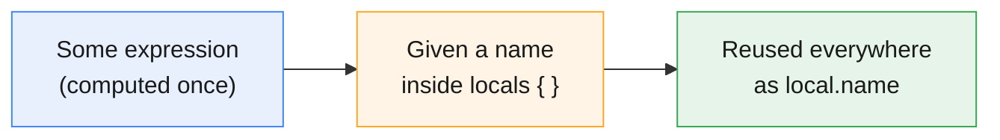
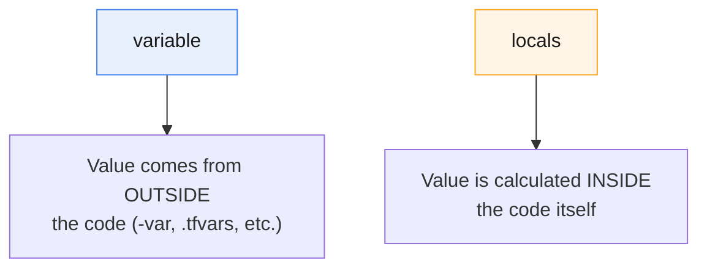

# Terraform Locals

:::info[Continuing from the last guides]
This page continues from **[Terraform Core Commands](./terraform-core-commands)**, **[Terraform Safety Nets](./terraform-tags-safteynets)**, **[Terraform Providers Explained](./terraform-providers)**, **[HCL Syntax Basics](./hcl-syntax)**, **[Terraform State Explained](./terraform-state)**, **[Terraform Input Variables](./terraform-input-variables)**, **[Terraform Outputs](./terraform-outputs)**, and **[Terraform Project Structure](./terraform-project-structure)**. You already saw a quick preview of `locals` in the HCL guide — this page covers everything about them.
:::

:::tip[Start your sandbox here]
👉 **[Launch the official Terraform Sandbox](https://developer.hashicorp.com/terraform/sandbox)** — every example below can be typed directly into a `main.tf` file there.
:::

---

## 1. What Is a Local?

A **local** is a named value you calculate once inside your code, and reuse anywhere you need it — instead of writing the same expression over and over.

:::tip[Think of it like a nickname]
If you keep saying "the restaurant two blocks past the big blue building on Main Street," you'd eventually just start calling it "Tony's." A local is that nickname — you work it out once, then just say `local.tonys` everywhere after.
:::



---

## 2. Declaring and Using a Local

```hcl
locals {
  bucket_name = "my-app-bucket"
}

resource "aws_s3_bucket" "demo" {
  bucket = local.bucket_name
}
```

| Part | What it means |
|---|---|
| `locals { ... }` | The block where you define one or more named values |
| `bucket_name = "..."` | The name you're giving this value, and the value itself |
| `local.bucket_name` | How you reference it anywhere else in your code |

:::note
Notice the block is called `locals` (plural) when declaring, but you reference one with `local` (singular) — `local.bucket_name`, not `locals.bucket_name`. This trips up almost every beginner at least once.
:::

---

## 3. Locals vs. Variables — The Key Difference

This is the single most important thing to understand about locals.

| | `variable` | `locals` |
|---|---|---|
| Where the value comes from | **Outside** — CLI flags, `.tfvars`, environment variables | **Inside** — calculated from your own code |
| Can someone else set it when running `apply`? | Yes | No |
| Typical use | Settings that change per environment (region, instance size) | Values computed from other values, so you don't repeat yourself |



:::tip[A simple rule of thumb]
If someone running `terraform apply` should be able to change it → use a **variable**.
If it's always derived from other values and nobody should set it directly → use a **local**.
:::

---

## 4. Why Bother? Avoiding Repetition

### Without locals — the same expression, copy-pasted everywhere

```hcl
variable "project" {
  type    = string
  default = "myapp"
}

variable "environment" {
  type    = string
  default = "sandbox"
}

resource "aws_s3_bucket" "demo" {
  bucket = "${var.project}-${var.environment}-bucket"

  tags = {
    Name = "${var.project}-${var.environment}-bucket"
  }
}

output "bucket_name" {
  value = "${var.project}-${var.environment}-bucket"
}
```

`"${var.project}-${var.environment}-bucket"` Three places with the exact same expression. If the naming pattern ever changes, you have to update it in three places — and it's easy to miss one.

### With locals — calculated once, used everywhere

```hcl
variable "project" {
  type    = string
  default = "myapp"
}

variable "environment" {
  type    = string
  default = "sandbox"
}

locals {
  bucket_name = "${var.project}-${var.environment}-bucket"
}

resource "aws_s3_bucket" "demo" {
  bucket = local.bucket_name

  tags = {
    Name = local.bucket_name
  }
}

output "bucket_name" {
  value = local.bucket_name
}
```

:::tip
Now the naming pattern lives in exactly **one** place. Change it once in `locals`, and every usage updates automatically.
:::

---

## 5. Multiple Locals, and Locals Referencing Each Other

You can define several locals in one block, and locals can even reference other locals.

```hcl
locals {
  project     = "myapp"
  environment = "sandbox"
  name_prefix = "${local.project}-${local.environment}"
  bucket_name = "${local.name_prefix}-bucket"
}

resource "aws_s3_bucket" "demo" {
  bucket = local.bucket_name
}
```

```
local.name_prefix  = "myapp-sandbox"
local.bucket_name  = "myapp-sandbox-bucket"
```

:::note
You can also have more than one `locals { }` block in the same project if it helps organize things — Terraform merges them all together. Most projects just use one.
:::

---

## 6. Common Pattern: Merging Tags

A very common, genuinely useful pattern — define a shared set of tags once, then merge in resource-specific ones.

```hcl
variable "environment" {
  type    = string
  default = "sandbox"
}

locals {
  common_tags = {
    Project     = "myapp"
    ManagedBy   = "terraform"
    Environment = var.environment
  }
}

resource "aws_s3_bucket" "demo" {
  bucket = "myapp-demo-bucket"

  tags = merge(local.common_tags, {
    Name = "demo-bucket"
  })
}

resource "aws_s3_bucket" "backup" {
  bucket = "myapp-backup-bucket"

  tags = merge(local.common_tags, {
    Name = "backup-bucket"
  })
}
```

Both buckets automatically get `Project`, `ManagedBy`, and `Environment`, plus their own unique `Name` — and if you need to add a new common tag later, you add it in exactly one place.

:::tip
`merge(a, b)` is a built-in Terraform function that combines two maps. If both maps have the same key, the **second** one wins.
:::

---

## 7. Common Pattern: A Conditional Local

Locals are also useful for picking a value based on a condition, so the resource block itself stays clean.

```hcl
variable "environment" {
  type    = string
  default = "sandbox"
}

locals {
  instance_type = var.environment == "prod" ? "t3.large" : "t3.micro"
}

resource "aws_instance" "app" {
  instance_type = local.instance_type
  ami           = "ami-0123456789"
}
```

:::tip[Think of it like a pre-decided answer]
Instead of writing the `? :` conditional directly inside the resource (and possibly repeating it elsewhere), you decide the answer once in `locals`, then just use `local.instance_type` wherever it's needed.
:::

---

## 8. When *Not* to Use Locals

Locals are easy to overuse. A couple of signs you've gone too far:

:::warning[Don't wrap everything in a local "just in case"]
If a value is used in exactly **one** place and isn't calculated from anything else, a local just adds an extra step for no benefit:

```hcl
# Unnecessary — this isn't saving repetition or doing any real calculation
locals {
  region = "us-east-1"
}

provider "aws" {
  region = local.region
}
```

Just write `region = "us-east-1"` directly, or use a `variable` if it should be configurable.
:::

:::note[Simple rule]
Use a local when a value is **reused** more than once, or **calculated** from something else. If it's neither, it probably doesn't need to be a local.
:::

---

## 9. Try It Yourself — Full Example

```hcl
variable "environment" {
  type    = string
  default = "sandbox"
}

locals {
  project     = "localspractice"
  name_prefix = "${local.project}-${var.environment}"

  common_tags = {
    Project     = local.project
    Environment = var.environment
    ManagedBy   = "terraform"
  }
}

resource "aws_s3_bucket" "demo" {
  bucket = "${local.name_prefix}-bucket"

  tags = merge(local.common_tags, {
    Name = "${local.name_prefix}-bucket"
  })
}

output "bucket_name" {
  value = aws_s3_bucket.demo.bucket
}

output "tags_applied" {
  value = aws_s3_bucket.demo.tags
}
```

```bash
terraform init
terraform plan
```

```
Plan: 1 to add, 0 to change, 0 to destroy.
```

```bash
terraform apply    # type yes
```

```
Outputs:

bucket_name  = "localspractice-sandbox-bucket"
tags_applied = {
  "Environment" = "sandbox"
  "ManagedBy"   = "terraform"
  "Name"        = "localspractice-sandbox-bucket"
  "Project"     = "localspractice"
}
```

```bash
terraform destroy    # type yes, to clean up
```

:::tip
Try changing `default = "sandbox"` to `default = "prod"` and re-run `terraform plan` — watch `name_prefix`, the bucket name, and the tags all update together, because they all trace back to `local.name_prefix` and `var.environment`.
:::

---

## Quick Reference

```hcl
# Declare locals
locals {
  name        = "value"
  computed    = "${local.name}-suffix"
  from_var    = "${var.environment}-${local.name}"
}

# Use a local
local.name

# Merge two maps (common with tags)
merge(local.common_tags, { Name = "specific-name" })

# Conditional local
locals {
  size = var.environment == "prod" ? "large" : "small"
}
```

## Cheat Sheet: Which One Do I Need?

| I want to... | Use this |
|---|---|
| Let someone set a value from outside the code | `variable`, not `locals` |
| Avoid repeating the same expression in multiple places | `locals` |
| Combine a shared tag set with resource-specific tags | `merge(local.common_tags, { ... })` |
| Pick a value based on a condition, cleanly | A `locals` block with `? :` |
| Build a value out of several other values | `locals` referencing `var.*` and other `local.*` |
| Store a value that's only used once and never changes | Just write it directly — skip `locals` |

---

## Summary

- A **local** is a named value calculated inside your code and reused with `local.<name>` — not something someone sets from outside, like a `variable` is.
- The main reason to use locals: **avoid repeating the same expression** in multiple places, so you only have to change it in one spot.
- Locals can reference variables, resources, and **other locals** — Terraform figures out the right order automatically.
- Two very common patterns: merging shared tags with `merge()`, and picking a value with a conditional (`? :`).
- Don't wrap a value in `locals` just because — only use it when a value is **reused** or **computed** from something else.