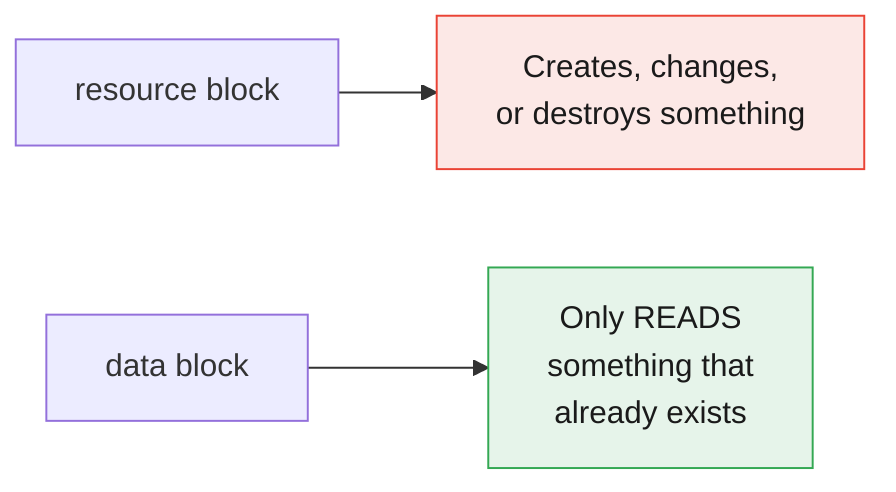
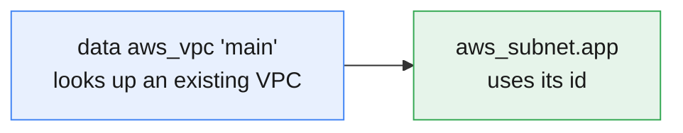
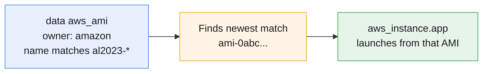
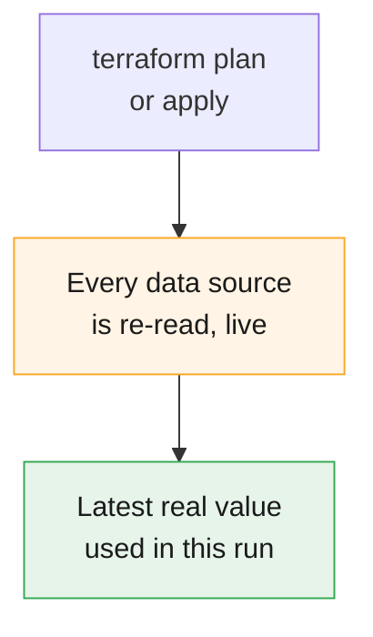

# Terraform Data Sources

:::info[Continuing from the last guides]
This page continues from **[Terraform Core Commands](./terraform-core-commands)**, **[Terraform Safety Nets](./terraform-tags-safteynets)**, **[Terraform Providers Explained](./terraform-providers)**, **[HCL Syntax Basics](./hcl-syntax)**, **[Terraform State Explained](./terraform-state)**, **[Terraform Input Variables](./terraform-input-variables)**, **[Terraform Outputs](./terraform-outputs)**, **[Terraform Project Structure](./terraform-project-structure)**, and **[Terraform Locals](./terraform-locals)**. Every `resource` block so far **created** something new — this page covers **reading** things that already exist.
:::

:::tip[Start your sandbox here]
👉 **[Launch the official Terraform Sandbox](https://developer.hashicorp.com/terraform/sandbox)** — every example below can be typed directly into a `main.tf` file there.
:::

---

## 1. What Is a Data Source?

A **data source** looks up information about something that **already exists** — created by hand, by another team, or by a different Terraform project — without Terraform creating, changing, or deleting it.

:::tip[Think of it like a lookup, not a purchase]
A `resource` block is like ordering something new. A `data` block is like looking something up in a catalog — you're just reading information, not buying anything.
:::



---

## 2. Declaring a Data Source

```hcl
data "aws_caller_identity" "current" {}
```

| Part | What it means |
|---|---|
| `data` | This is a lookup, not a creation |
| `"aws_caller_identity"` | The *type* — what kind of information to look up |
| `"current"` | Your nickname for this lookup, used to reference it later |

### Referencing its value

```hcl
output "account_id" {
  value = data.aws_caller_identity.current.account_id
}
```

The pattern is always: **`data.<type>.<name>.<attribute>`** — very similar to how you reference a resource, just starting with `data.` instead.

```bash
terraform apply
```

```
Outputs:

account_id = "123456789012"
```

:::note
`aws_caller_identity` needs no input — it just tells you who (which AWS account) Terraform is currently authenticated as. It's a handy one to practice with first.
:::

---

## 3. `resource` vs. `data` — Side by Side

| | `resource` | `data` |
|---|---|---|
| What it does | Creates / updates / destroys | Only reads |
| Shows up in `terraform destroy`? | Yes — gets destroyed | No — nothing to destroy, it was never created by Terraform |
| Appears in `plan` as | `+`, `~`, or `-/+` | Just a quiet "Read" step |
| Typical use | "Build me an S3 bucket" | "Tell me the ID of the VPC that already exists" |

```bash
terraform plan
```

```
data.aws_caller_identity.current: Reading...
data.aws_caller_identity.current: Read complete after 1s

No changes. Your infrastructure matches the configuration.
```

:::tip
Notice the word **"Reading"**, not "Creating" — that's the clearest visual sign you're looking at a data source doing its job.
:::

---

## 4. A More Realistic Example: Looking Up an Existing VPC

Say your company already has a VPC set up by another team, and you just need its ID to launch a resource into it.

:::warning[A data source can only find something that already exists]
`data "aws_vpc"` with a `filter` **looks up** a VPC — it never creates one. If nothing in your account matches the filter, `plan` fails with `no matching EC2 VPC found`. In a fresh sandbox there's no `main-vpc` yet, so the snippet below creates one first (standing in for "a VPC another team already set up"), then looks it up by its tag — exactly like you'd do in a real account.
:::

```hcl
resource "aws_vpc" "existing" {
  cidr_block = "10.0.0.0/16"

  tags = {
    Name = "main-vpc"
  }
}

data "aws_vpc" "main" {
  filter {
    name   = "tag:Name"
    values = ["main-vpc"]
  }

  depends_on = [aws_vpc.existing]
}

resource "aws_subnet" "app" {
  vpc_id     = data.aws_vpc.main.id
  cidr_block = "10.0.1.0/24"
}
```

:::note
The `filter` block tells Terraform **how to find** the right VPC — here, by matching its `Name` tag. Most data sources that look up existing infrastructure need some kind of filter or ID so Terraform knows exactly which one you mean. (The `depends_on` here only exists because this example also *creates* the VPC in the same run — in your company's real VPC, you'd just use the `data` block on its own, with no `depends_on` needed.)
:::



---

## 5. Another Common Example: Finding the Latest AMI

A very common real-world use — instead of hardcoding an AMI ID (which changes over time and differs per region), look up the latest one automatically.

:::info[What is an AMI?]
**AMI** = **Amazon Machine Image**. It's a ready-made template for a server (an operating system plus any pre-installed software). Every EC2 instance you launch starts from one. Each AMI has an ID like `ami-0abc123`, and that ID is different in every region and changes when Amazon releases updates — so we look it up instead of hardcoding it.
:::

```hcl
data "aws_ami" "latest_amazon_linux" {
  most_recent = true
  owners      = ["amazon"]

  filter {
    name   = "name"
    values = ["al2023-ami-*-x86_64"]
  }
}

resource "aws_instance" "app" {
  ami           = data.aws_ami.latest_amazon_linux.id
  instance_type = "t3.micro"
}
```

### What each part does

| Line | Meaning |
|---|---|
| `most_recent = true` | Several images may match — pick the **newest** one |
| `owners = ["amazon"]` | Only trust images **published by Amazon**, not lookalikes from strangers (always include this) |
| `filter { name = "name" ... }` | Narrow the search by the image's **name** |
| `values = ["al2023-ami-*-x86_64"]` | The name pattern to match. `al2023` = Amazon Linux 2023, `*` = any version/date, `x86_64` = standard 64-bit processor |
| `ami = data.aws_ami....id` | Launch the server from the image we just found |
| `instance_type = "t3.micro"` | The **size** of the server (small and cheap) |



:::tip
Without this, you'd have to manually find and hardcode an AMI ID — and it would silently go out of date. With the data source, `plan` always resolves to whatever the *actual* latest matching AMI is, right now.
:::

:::warning[Sandbox note]
Like the VPC example, a data source can only find what already exists. On **real AWS**, Amazon's public AMIs exist, so this works. In a **LocalStack sandbox** they may not, and you could see `no matching EC2 AMI found` — that's expected. For practice there, use a hardcoded dummy like `ami = "ami-0123456789"` instead.
:::

---

## 6. Data Sources Depend on Things Too

Most of the time, Terraform figures out the right order automatically — because you reference the data source's result somewhere else.

```hcl
resource "aws_s3_bucket" "demo" {
  bucket = "my-practice-bucket"
}

data "aws_s3_bucket" "demo_lookup" {
  bucket = aws_s3_bucket.demo.bucket
}
```

Here, Terraform knows to create the bucket **first**, then run the lookup — because the data source's `bucket` argument references the resource.

### When there's no natural reference: `depends_on`

Occasionally a data source depends on something that finishes in AWS slightly *after* Terraform considers it "created" (like IAM permissions taking a moment to propagate). In that rare case, you can force the order explicitly:

```hcl
resource "aws_s3_bucket" "demo" {
  bucket = "my-practice-bucket"
}

data "aws_s3_bucket" "demo_lookup" {
  bucket     = "my-practice-bucket"
  depends_on = [aws_s3_bucket.demo]
}
```

:::warning
Only add `depends_on` when there's genuinely no natural reference connecting the two. If you're already using `aws_s3_bucket.demo.bucket` like the example above, Terraform already understands the order — adding `depends_on` on top of that is unnecessary.
:::

---

## 7. Data Sources Are Re-Checked Every Plan

Unlike a resource (whose state Terraform trusts between runs), a data source is **re-read** every single time you run `plan` or `apply` — Terraform always goes and checks the real, current value.



:::note
This is exactly why the "latest AMI" example works well — every time you `plan`, it checks what the actual latest AMI is *right now*, not what it was the last time you applied.
:::

---

## 8. Try It Yourself — Full Example

```hcl
data "aws_caller_identity" "current" {}

data "aws_region" "current" {}

resource "aws_s3_bucket" "demo" {
  bucket = "data-source-practice-${data.aws_caller_identity.current.account_id}"

  tags = {
    Region = data.aws_region.current.name
  }
}

output "account_id" {
  value = data.aws_caller_identity.current.account_id
}

output "region" {
  value = data.aws_region.current.name
}

output "bucket_name" {
  value = aws_s3_bucket.demo.bucket
}
```

```bash
terraform init
terraform plan
```

```
data.aws_caller_identity.current: Reading...
data.aws_region.current: Reading...
data.aws_caller_identity.current: Read complete after 0s
data.aws_region.current: Read complete after 0s

Plan: 1 to add, 0 to change, 0 to destroy.
```

```bash
terraform apply    # type yes
```

```
Outputs:

account_id  = "000000000000"
bucket_name = "data-source-practice-000000000000"
region      = "us-east-1"
```

```bash
terraform destroy    # type yes, to clean up
```

:::tip
In LocalStack sandboxes, `account_id` is usually a dummy value like `000000000000` — that's expected, and still demonstrates the pattern correctly.
:::

---

## Quick Reference

```hcl
# Declare a data source
data "<type>" "<name>" {
  # arguments or filters, depending on the type
}

# Reference its value
data.<type>.<name>.<attribute>

# Force an explicit order when there's no natural reference
data "<type>" "<name>" {
  depends_on = [resource_type.name]
}
```

```bash
terraform plan
# Look for "Reading..." / "Read complete" — that's a data source at work
```

## Cheat Sheet: Which One Do I Need?

| I want to... | Use this |
|---|---|
| Create something new | `resource` |
| Read something that already exists | `data` |
| Find the current AWS account ID | `data "aws_caller_identity"` |
| Find the current region | `data "aws_region"` |
| Look up an existing VPC, subnet, or similar | `data "aws_vpc"` (or the matching type) with a `filter` |
| Always use the latest AMI, without hardcoding | `data "aws_ami"` with `most_recent = true` |
| Force a data source to wait for a resource, with no natural link | `depends_on` inside the `data` block |

---

## Summary

- A **data source** reads existing information — it never creates, changes, or destroys anything.
- Declared as `data "<type>" "<name>" { ... }`, referenced as `data.<type>.<name>.<attribute>` — the same pattern as resources, just starting with `data`.
- Most lookup-style data sources need a `filter` (or an ID) so Terraform knows exactly which existing thing you mean.
- Terraform usually figures out the right order automatically when you reference a data source's result; use `depends_on` only when there's no natural reference.
- Unlike resources, data sources are **re-read every single `plan`/`apply`**, always reflecting the current real value.