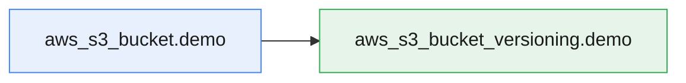
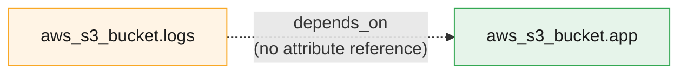
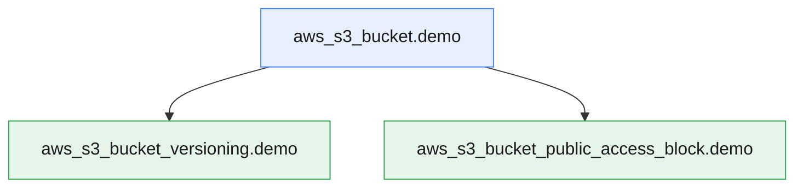
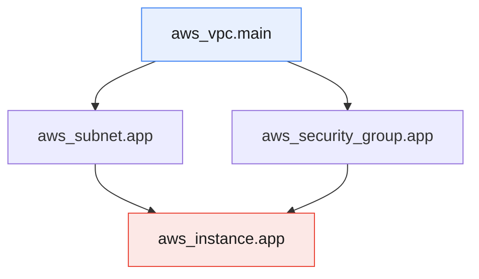
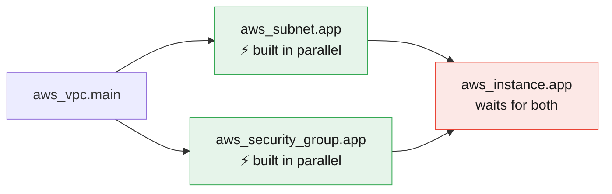
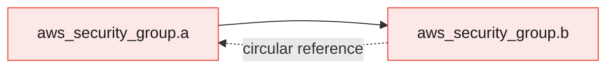
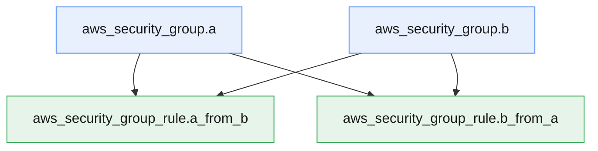

# Terraform Resource Dependencies

:::info[Continuing from the last guides]
This page continues from **[Terraform Core Commands](./terraform-core-commands)**, **[Terraform Safety Nets](./terraform-tags-safteynets)**, **[Terraform Providers Explained](./terraform-providers)**, **[HCL Syntax Basics](./hcl-syntax)**, **[Terraform State Explained](./terraform-state)**, **[Terraform Input Variables](./terraform-input-variables)**, **[Terraform Outputs](./terraform-outputs)**, **[Terraform Project Structure](./terraform-project-structure)**, **[Terraform Locals](./terraform-locals)**, and **[Terraform Data Sources](./terraform-data-sources)**. You've already *used* dependencies without naming them — every time you referenced one resource's attribute from another. This page explains exactly how that works.
:::

:::tip[Start your sandbox here]
👉 **[Launch the official Terraform Sandbox](https://developer.hashicorp.com/terraform/sandbox)** — every example below can be typed directly into a `main.tf` file there.
:::

---

## 1. Why Order Matters

You can't attach a subnet to a VPC that doesn't exist yet. You can't put an object in a bucket before the bucket exists. Terraform has to build things in the **right order** — and most of the time, it figures that out entirely on its own.

:::tip[Think of it like following a recipe]
You can't frost a cake before you bake it. A recipe's steps have a natural order based on what depends on what — Terraform works out that same kind of order for your infrastructure.
:::

---

## 2. Implicit Dependencies — The Normal Case

Whenever one resource **references** another resource's attribute, Terraform automatically knows the referenced one must be created first. You don't have to tell it anything extra.

```hcl
resource "aws_s3_bucket" "demo" {
  bucket = "dependency-practice-bucket"
}

resource "aws_s3_bucket_versioning" "demo" {
  bucket = aws_s3_bucket.demo.id   # <- this reference IS the dependency
  versioning_configuration {
    status = "Enabled"
  }
}
```

Because `aws_s3_bucket_versioning.demo` uses `aws_s3_bucket.demo.id`, Terraform knows: **create the bucket first, then configure versioning on it.**



```bash
terraform apply
```

```
aws_s3_bucket.demo: Creating...
aws_s3_bucket.demo: Creation complete after 2s
aws_s3_bucket_versioning.demo: Creating...
aws_s3_bucket_versioning.demo: Creation complete after 1s
```

:::note
Notice the order in the output — the bucket finishes **before** versioning even starts. That's the implicit dependency at work, not luck.
:::

:::tip[The rule of thumb]
If you're referencing `resource_type.name.attribute` anywhere inside another resource, you already have a dependency — you never need to add anything extra for it.
:::

---

## 3. Explicit Dependencies — `depends_on`

Sometimes two resources are related, but **not through any attribute reference** — so Terraform has no way to know one must come before the other. That's what `depends_on` is for.

### Simple example

```hcl
resource "aws_s3_bucket" "logs" {
  bucket = "depends-on-logs-bucket"
}

resource "aws_s3_bucket" "app" {
  bucket = "depends-on-app-bucket"

  depends_on = [aws_s3_bucket.logs]
}
```

`aws_s3_bucket.app` doesn't use anything from `aws_s3_bucket.logs` — there's no reference between them. But we want the logs bucket to exist first, so we say so explicitly with `depends_on`.

```bash
terraform apply    # type yes
```

```
aws_s3_bucket.logs: Creating...
aws_s3_bucket.logs: Creation complete after 1s
aws_s3_bucket.app: Creating...
aws_s3_bucket.app: Creation complete after 1s
```



### Real-world example: a server that needs a permission first

A server often needs an IAM permission attached **before** it boots, even though nothing in the server's code references that permission. Here the role, the policy document, and the policy are all declared together, and `depends_on` makes the server wait for the policy.

```hcl
resource "aws_iam_role" "demo" {
  name = "demo-role"

  assume_role_policy = jsonencode({
    Version = "2012-10-17"
    Statement = [{
      Action    = "sts:AssumeRole"
      Effect    = "Allow"
      Principal = { Service = "ec2.amazonaws.com" }
    }]
  })
}

data "aws_iam_policy_document" "demo" {
  statement {
    actions   = ["s3:ListAllMyBuckets"]
    resources = ["*"]
  }
}

resource "aws_iam_role_policy" "demo" {
  name   = "demo-policy"
  role   = aws_iam_role.demo.id
  policy = data.aws_iam_policy_document.demo.json
}

resource "aws_instance" "app" {
  ami           = "ami-0123456789"
  instance_type = "t3.micro"

  depends_on = [aws_iam_role_policy.demo]
}
```

:::warning
Only reach for `depends_on` when there's truly **no** natural reference connecting the two resources. If you can instead reference an attribute (even one you don't strictly need), that's the preferred way — it keeps the dependency visible and self-documenting.
:::

---

## 4. Multiple Resources Depending on One (Fan-Out)

It's common for several resources to all depend on the same one.

```hcl
resource "aws_s3_bucket" "demo" {
  bucket = "fanout-practice-bucket"
}

resource "aws_s3_bucket_versioning" "demo" {
  bucket = aws_s3_bucket.demo.id
  versioning_configuration {
    status = "Enabled"
  }
}

resource "aws_s3_bucket_public_access_block" "demo" {
  bucket                  = aws_s3_bucket.demo.id
  block_public_acls       = true
  block_public_policy     = true
}
```



:::tip
`versioning` and `public_access_block` don't depend on each other at all — only on the bucket. Terraform notices this and creates both of them **at the same time**, in parallel, once the bucket is ready. More on this in Section 6.
:::

---

## 5. One Resource Depending on Multiple (Fan-In)

The reverse is just as common — one resource needs several others to exist first.

```hcl
resource "aws_vpc" "main" {
  cidr_block = "10.0.0.0/16"
}

resource "aws_subnet" "app" {
  vpc_id     = aws_vpc.main.id
  cidr_block = "10.0.1.0/24"
}

resource "aws_security_group" "app" {
  vpc_id = aws_vpc.main.id
}

resource "aws_instance" "app" {
  ami                    = "ami-0123456789"
  instance_type          = "t3.micro"
  subnet_id              = aws_subnet.app.id
  vpc_security_group_ids = [aws_security_group.app.id]
}
```



`aws_instance.app` can't start until **both** the subnet and the security group exist — and both of those can't exist until the VPC does.

---

## 6. Parallelism — Terraform Builds What It Can, at the Same Time

Terraform doesn't build resources one at a time, top to bottom. It builds everything it **can** build at once, and only waits where a real dependency requires it.



:::note
This is exactly why dependencies matter so much — they're not just about correctness, they're also what lets Terraform safely speed things up by doing independent work simultaneously.
:::

---

## 7. Seeing the Graph Yourself

Terraform can print its entire dependency graph as plain text, in a format called DOT:

```bash
terraform graph
```

The output is long (it includes extra bookkeeping lines), but the lines that matter look like this — shown here trimmed for the VPC example from Section 5:

```
"aws_subnet.app" -> "aws_vpc.main"
"aws_security_group.app" -> "aws_vpc.main"
"aws_instance.app" -> "aws_subnet.app"
"aws_instance.app" -> "aws_security_group.app"
```

:::note[Read the arrows as "needs"]
In `terraform graph`, an arrow points **from a resource to the thing it needs**: `"aws_subnet.app" -> "aws_vpc.main"` means "the subnet needs the VPC." This is the reverse of the Mermaid diagrams on this page, which point in **build order** (VPC first, then subnet). Same relationships, opposite arrow direction. The exact text also varies slightly between Terraform versions (newer ones add `[root]` and `(expand)` to each name).
:::

:::tip
You normally won't read this raw output directly — tools like Graphviz can turn it into an actual picture. What matters is knowing that Terraform builds this graph internally for every project, and uses it to decide order and parallelism.
:::

---

## 8. Circular Dependencies — When Things Point at Each Other

If Resource A depends on Resource B, and Resource B also depends on Resource A, Terraform has no valid order to build them in — and it will refuse to proceed.

### See the error yourself

Two security groups that each allow traffic from the other, written inline, create a real cycle:

```hcl
resource "aws_vpc" "main" {
  cidr_block = "10.0.0.0/16"
}

resource "aws_security_group" "a" {
  name   = "demo-group-a"
  vpc_id = aws_vpc.main.id

  ingress {
    from_port       = 80
    to_port         = 80
    protocol        = "tcp"
    security_groups = [aws_security_group.b.id]
  }
}

resource "aws_security_group" "b" {
  name   = "demo-group-b"
  vpc_id = aws_vpc.main.id

  ingress {
    from_port       = 80
    to_port         = 80
    protocol        = "tcp"
    security_groups = [aws_security_group.a.id]
  }
}
```

```bash
terraform plan
```

```
│ Error: Cycle: aws_security_group.a, aws_security_group.b
```

:::note
The names in the error can appear in either order, and newer Terraform versions may word it slightly differently — what matters is that both resources are listed as part of the cycle. Nothing gets created; `plan` stops before touching anything.
:::



### The fix: break the loop with separate rule resources

Create both groups **empty** first, then add the rules as their own resources. Now the rules depend on the groups, but the groups don't depend on each other.

```hcl
resource "aws_vpc" "main" {
  cidr_block = "10.0.0.0/16"
}

resource "aws_security_group" "a" {
  name   = "demo-group-a"
  vpc_id = aws_vpc.main.id
}

resource "aws_security_group" "b" {
  name   = "demo-group-b"
  vpc_id = aws_vpc.main.id
}

resource "aws_security_group_rule" "a_from_b" {
  type                     = "ingress"
  from_port                = 80
  to_port                  = 80
  protocol                 = "tcp"
  security_group_id        = aws_security_group.a.id
  source_security_group_id = aws_security_group.b.id
}

resource "aws_security_group_rule" "b_from_a" {
  type                     = "ingress"
  from_port                = 80
  to_port                  = 80
  protocol                 = "tcp"
  security_group_id        = aws_security_group.b.id
  source_security_group_id = aws_security_group.a.id
}
```

```bash
terraform plan
```

```
Plan: 5 to add, 0 to change, 0 to destroy.
```



:::danger
A cycle always means your design needs to change — Terraform can't "guess" an order that doesn't exist. The usual fix is to pull the part that creates the loop (here, the rules) out into its own resource, so the arrows only ever go one way.
:::

---

## 9. Try It Yourself — Full Example

```hcl
resource "aws_s3_bucket" "demo" {
  bucket = "dependency-practice-bucket"
}

resource "aws_s3_bucket_versioning" "versioning" {
  bucket = aws_s3_bucket.demo.id
  versioning_configuration {
    status = "Enabled"
  }
}

resource "aws_s3_bucket_public_access_block" "block" {
  bucket              = aws_s3_bucket.demo.id
  block_public_acls   = true
  block_public_policy = true
}

output "bucket_name" {
  value = aws_s3_bucket.demo.bucket
}
```

```bash
terraform init
terraform graph | grep "\->"
```

```
"aws_s3_bucket_versioning.versioning" -> "aws_s3_bucket.demo"
"aws_s3_bucket_public_access_block.block" -> "aws_s3_bucket.demo"
```

Each line reads "this resource **needs** that one" — both the versioning and the access block need the bucket. (Your output may show extra `[root]` / `(expand)` text depending on your Terraform version.)

```bash
terraform apply    # type yes — watch the bucket finish before the other two start
terraform destroy   # type yes, to clean up — notice it reverses the order!
```

:::tip
Watch `terraform destroy` carefully — it tears things down in the **opposite** order from how they were built. The versioning and access block get destroyed first, then the bucket last, since nothing can depend on a bucket that's already gone.
:::

---

## Quick Reference

```hcl
# Syntax shape only (placeholder names)
# Implicit dependency — just reference the attribute
resource "b" "example" {
  some_field = a.example.id
}

# Explicit dependency — no natural reference exists
resource "b" "example" {
  depends_on = [a.example]
}
```

```bash
# See the full dependency graph as text
terraform graph

# See just the "A depends on B" lines
terraform graph | grep "\->"
```

## Cheat Sheet: Which One Do I Need?

| I want to... | Use this |
|---|---|
| Make sure A is created before B, and B actually uses A's data | Reference `a.example.attribute` inside B (implicit) |
| Make sure A is created before B, but B doesn't use any of A's data | `depends_on = [a.example]` (explicit) |
| Let Terraform build unrelated resources at the same time | Nothing — this happens automatically when there's no dependency |
| See the full build order Terraform computed | `terraform graph` |
| Understand a "Cycle" error | Two resources reference each other — break the loop by moving the shared part into its own resource |

---

## Summary

- Terraform builds resources in dependency order, and runs anything **independent** in parallel automatically.
- **Implicit dependencies** happen automatically whenever you reference `resource_type.name.attribute` — this is the normal, preferred way.
- **Explicit dependencies** (`depends_on`) are for the rare case where two resources are related but share no attribute reference.
- Dependencies can **fan out** (many resources depending on one) or **fan in** (one resource depending on many) — Terraform handles both the same way.
- `terraform graph` prints the exact dependency graph Terraform computed, useful for understanding or debugging build order.
- A **circular dependency** (A needs B, B needs A) has no valid order and always errors — fix it by moving the part that creates the loop into its own resource, so references only go one way.
- `terraform destroy` tears resources down in the **reverse** order they were built in.