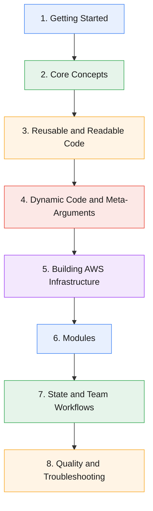

# Terraform Fundamentals

Terraform is an infrastructure-as-code tool for provisioning and changing infrastructure through declarative configuration. You describe the desired result, and Terraform determines the changes required to reach it.

:::tip[Practice as you read]
👉 **[Launch the official Terraform Sandbox](https://developer.hashicorp.com/terraform/sandbox)**. It comes with Terraform, Docker, LocalStack, and the AWS CLI already set up, so you can try the examples without installing anything.
:::

---

## The Learning Path

The pages below are arranged in the order that works best for a newcomer. Each stage builds on the one before it.



:::info[How to use this guide]
- **New to Terraform?** Follow the numbers from 1 to 32 in order.
- **Already know the basics?** Jump straight to the part you need.
- **Status:** ✅ means the page is ready to read. 🚧 means it is planned and coming soon.
:::

---

## The Building Blocks at a Glance

Every Terraform project is made from the same handful of pieces. This table is a quick map of what each one is for.

| Building block | What it is | Example |
|---|---|---|
| **Provider** | A plugin that lets Terraform talk to a service such as AWS | `provider "aws" { ... }` |
| **Resource** | Something Terraform creates and manages | `resource "aws_s3_bucket" "demo" { ... }` |
| **Data source** | A read-only lookup of something that already exists | `data "aws_vpc" "main" { ... }` |
| **Variable** | An input value supplied from outside the code | `var.region` |
| **Local** | A named value calculated inside the code | `local.bucket_name` |
| **Output** | A value shown or shared after `apply` | `output "bucket_name" { ... }` |
| **Module** | A reusable folder of Terraform code | `module "network" { ... }` |
| **State** | Terraform's record of what it has already built | `terraform.tfstate` |

### The workflow in four commands

```bash
terraform init      # download the providers your code needs
terraform plan      # preview what will change
terraform apply     # build it for real
terraform destroy   # remove everything when you are done
```

---

## Part 1: Getting Started

Install Terraform, give it access to AWS, and run the four commands you will use every day.

| # | Topic | What you will learn | Status |
|---|---|---|---|
| 1 | [Installing Terraform](./installation) | Install the Terraform CLI and check that it works | ✅ Ready |
| 2 | [Connecting Terraform to AWS](./connect-terraform-to-aws) | Give Terraform credentials and a region so it can create real resources | ✅ Ready |
| 3 | [Terraform Core Commands](./terraform-core-commands) | The four commands you use every time: `init`, `plan`, `apply`, `destroy` | ✅ Ready |

---

## Part 2: Core Concepts

The ideas that every later page relies on.

| # | Topic | What you will learn | Status |
|---|---|---|---|
| 4 | [Terraform Safety Nets](./terraform-tags-safteynets) | Tags, `prevent_destroy`, replace vs update, and renaming safely | ✅ Ready |
| 5 | [Terraform Providers Explained](./terraform-providers) | What providers are, how to pin versions, and how to use several at once | ✅ Ready |
| 6 | [HCL Syntax Basics](./hcl-syntax) | Blocks, arguments, types, and expressions | ✅ Ready |
| 7 | [Terraform State](./terraform-state) | What the state file is, local vs remote, locking, and drift | ✅ Ready |

---

## Part 3: Reusable and Readable Code

Stop hardcoding values and start organizing your project.

| # | Topic | What you will learn | Status |
|---|---|---|---|
| 8 | [Terraform Input Variables](./terraform-input-variables) | Types, defaults, validation, and all the ways to set a value | ✅ Ready |
| 9 | [Terraform Outputs](./terraform-outputs) | Show and share values after `apply` | ✅ Ready |
| 10 | [Terraform Project Structure](./terraform-project-structure) | Standard files, folders, and separating environments | ✅ Ready |
| 11 | [Terraform Locals](./terraform-locals) | Name a value once and reuse it everywhere | ✅ Ready |
| 12 | [Terraform Data Sources](./terraform-data-sources) | Read information about things that already exist | ✅ Ready |
| 13 | [Terraform Resource Dependencies](./terraform-resource-dependencies) | How Terraform decides the build order, and when to use `depends_on` | ✅ Ready |

---

## Part 4: Dynamic Code and Meta-Arguments

Create many resources from one block, and make choices inside your code.

| # | Topic | What you will learn | Status |
|---|---|---|---|
| 14 | `count` | Create several copies of a resource | 🚧 Coming soon |
| 15 | `for_each` | Create resources from a map or a set, each with its own settings | 🚧 Coming soon |
| 16 | Conditional Expressions | Choose a value with `condition ? a : b` | 🚧 Coming soon |
| 17 | Built-in Functions | Work with strings, lists, maps, and more | 🚧 Coming soon |
| 18 | Lifecycle Meta-Arguments | Control how Terraform creates, replaces, and protects resources | 🚧 Coming soon |

---

## Part 5: Building AWS Infrastructure

Put the concepts to work on real AWS services.

| # | Topic | What you will learn | Status |
|---|---|---|---|
| 19 | VPCs and Subnets | Build the network your resources live in | 🚧 Coming soon |
| 20 | Security Groups | Control which traffic can reach your resources | 🚧 Coming soon |
| 21 | EC2 Instances | Launch servers into your network | 🚧 Coming soon |
| 22 | IAM | Roles, policies, and least-privilege access | 🚧 Coming soon |
| 23 | SSM Parameters and Secrets | Keep configuration and secrets out of your code | 🚧 Coming soon |
| 24 | DynamoDB | Create and manage NoSQL tables | 🚧 Coming soon |
| 25 | Lambda and SQS | Run serverless functions and connect them with queues | 🚧 Coming soon |

:::note[Why networking comes before servers]
An EC2 instance needs a subnet and a security group to launch into, so VPCs and Subnets (19) and Security Groups (20) come before EC2 Instances (21).
:::

---

## Part 6: Modules

Package your configuration so it can be reused.

| # | Topic | What you will learn | Status |
|---|---|---|---|
| 26 | Using Modules | Call existing modules and pass them values | 🚧 Coming soon |
| 27 | Writing Modules | Build your own reusable modules with inputs and outputs | 🚧 Coming soon |

---

## Part 7: State and Team Workflows

Work safely as a team and as your state grows.

| # | Topic | What you will learn | Status |
|---|---|---|---|
| 28 | Remote State on S3 | Store state in a shared bucket with locking | 🚧 Coming soon |
| 29 | Workspaces | Keep separate state for each environment from one codebase | 🚧 Coming soon |
| 30 | Moving and Removing State | Rename or stop tracking resources without destroying them | 🚧 Coming soon |
| 31 | Import and Replace | Bring existing resources under Terraform, and force a rebuild when needed | 🚧 Coming soon |

---

## Part 8: Quality and Troubleshooting

Keep your code clean and find problems early.

| # | Topic | What you will learn | Status |
|---|---|---|---|
| 32 | `fmt`, `validate`, and Debugging Drift | Format and check your code, then find and fix differences between your code and reality | 🚧 Coming soon |

---

## More to Explore

Topics that pair well with everything above and may be added later:

- `dynamic` blocks for generating repeated nested settings
- `terraform console` for testing expressions interactively
- Security best practices for secrets and state
- Running Terraform in a CI/CD pipeline
- Writing automated tests with `terraform test`